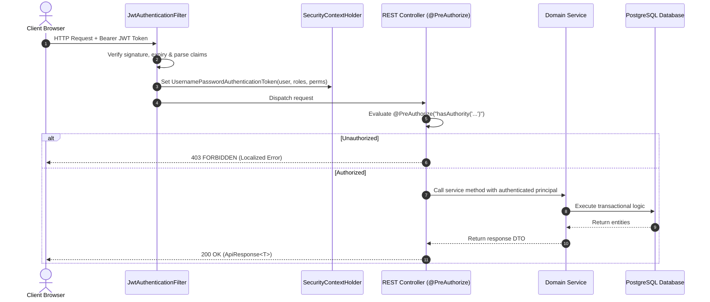
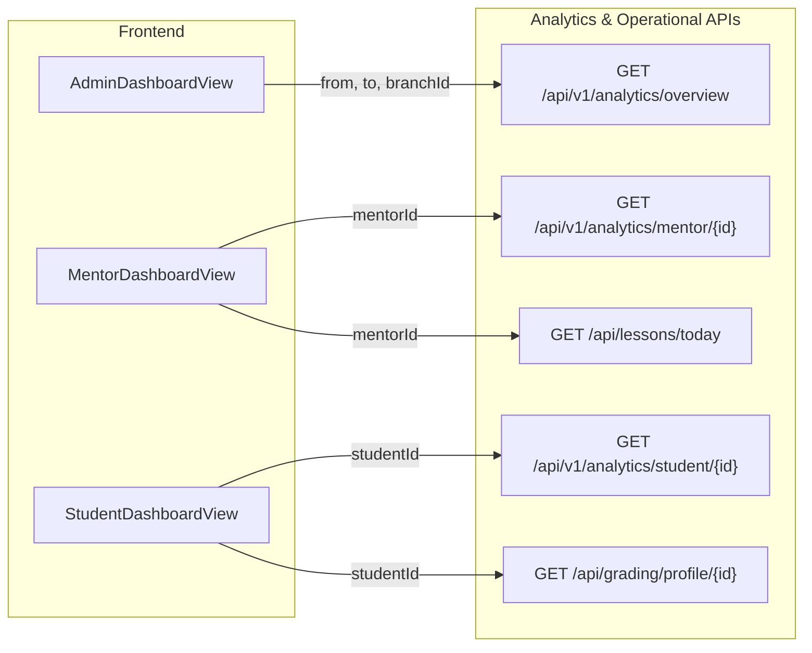

# AXM Nexus — Architecture & Engineering Recommendations
**Muhammad al-Xorazmiy Vorislari Digital Education Management Platform**

This document establishes the architectural blueprint, patterns, standards, and engineering practices required to transition AXM Nexus into a secure, scalable, enterprise-grade educational ecosystem.

---

## 1. Architectural Style: Pragmatic Modular Monolith with DDD

```mermaid
flowchart TD
    Client["React 19 SPA (Client)"] --> Gateway["Spring Security Filter Chain (Stateless JWT)"]
    
    subgraph ModularMonolith["AXM Nexus Core (Modular Monolith)"]
        direction TB
        Access["Access & RBAC Module"]
        Identity["Identity & Auth Module"]
        Classrooms["Branches, Classes & Groups Module"]
        Users["Users & Student Registry Module"]
        Mentors["Mentor Profiles & Directory Module"]
        Education["Curriculum & Subject Track Module"]
        Lessons["80-Min Lesson Planning Module"]
        Scheduling["Timetable & Attendance Module"]
        Assessments["Assessments, Quizzes & Assignments"]
        Grading["Grading, XP & Gamification Module"]
        Analytics["Real-time Analytics & KPI Aggregator"]
        AiModule["AI Assistant & Document Parser"]
        Audit["Audit Logging & System Configuration"]
        Notifications["Notification Center & Outbox"]
        Reports["Official Document & PDF Exporter"]
    end

    Gateway --> Access
    Gateway --> Identity
    Gateway --> Scheduling
    Gateway --> Lessons
    Gateway --> Assessments
    Gateway --> Grading
    Gateway --> Analytics

    ModularMonolith --> DB[(PostgreSQL 16 Database)]
    ModularMonolith --> Cache[(Redis Cache)]
```



### Core Architectural Principles
1. **Strict Modular Boundaries:** Each business domain resides in its dedicated package under `uz.axm.nexus.<domain>`. Inter-module communication must happen via public service contracts (`@Service`) or Spring application domain events, avoiding direct cross-repository queries or circular dependencies.
2. **DTO-Driven Presentation Layer:** No controller must ever accept or return a raw JPA `@Entity`. All endpoints must receive dedicated request DTOs with Bean Validation (`@Valid`, `@NotNull`, `@Size`) and return standardized `ApiResponse<T>` or `PageResponse<T>` envelopes.
3. **Domain Invariants Enforced in Service Layer:** Business rules (e.g. mentor time conflicts, room occupancy, group capacity limits of 16 students) must be enforced transactionally inside domain services, backed by database constraints.
4. **Auditability by Design:** Every mutating state change must automatically record an entry into `audit_logs` capturing the authenticated username, entity type, entity ID, action, and timestamp.

---

## 2. Security Architecture & RBAC Hardening

### 2.1 Defense-in-Depth Security Model


### 2.2 Security Remediation Actions
1. **Hardened Filter Chain in `SecurityConfig.java`:**
   ```java
   http
       .csrf(AbstractHttpConfigurer::disable)
       .cors(Customizer.withDefaults())
       .sessionManagement(s -> s.sessionCreationPolicy(SessionCreationPolicy.STATELESS))
       .authorizeHttpRequests(auth -> auth
           .requestMatchers(
               "/api/v1/auth/**",
               "/swagger-ui/**",
               "/swagger-ui.html",
               "/v3/api-docs/**",
               "/actuator/health",
               "/static/**",
               "/uploads/**"
           ).permitAll()
           .anyRequest().authenticated() // Strict enforcement: all business endpoints require JWT
       )
       .addFilterBefore(jwtAuthenticationFilter, UsernamePasswordAuthenticationFilter.class);
   ```
2. **Elimination of Spoofable Headers:**
   Remove all `@RequestHeader("X-Admin-User")`, `@RequestHeader("X-User-Role")`, and `@RequestHeader("X-User-Id")`. The identity must always be obtained via:
   ```java
   String currentUsername = SecurityContextHolder.getContext().getAuthentication().getName();
   ```
3. **Elimination of Default Admin Fallback in `CurrentUserHelper`:**
   ```java
   public Long getCurrentUserId() {
       return getCurrentUser()
               .map(User::getId)
               .orElseThrow(() -> new AccessDeniedException("Foydalanuvchi tizimga kirmagan"));
   }
   ```
4. **Mandatory Method Security on All Controllers:**
   Ensure every method in `StudentController`, `MentorController`, `StudyGroupController`, `LessonAttendanceController`, and `AiAssistantController` carries an explicit `@PreAuthorize("hasAuthority('...')")` annotation.

---

## 3. Database & Schema Architecture Recommendations

### 3.1 Schema Fixes via Liquibase Migration 014
Create `014-structural-fixes-and-academic-hierarchy.sql`:

1. **Fix Student-to-User Relationship:**
   ```sql
   ALTER TABLE students ADD COLUMN IF NOT EXISTS user_id BIGINT UNIQUE REFERENCES users(id) ON DELETE SET NULL;
   CREATE INDEX IF NOT EXISTS idx_students_user_id ON students(user_id);
   ```
2. **Fix Outcome Evaluations Foreign Key:**
   ```sql
   ALTER TABLE student_learning_outcome_evaluations 
       DROP CONSTRAINT IF EXISTS student_learning_outcome_evaluations_student_id_fkey;
   ALTER TABLE student_learning_outcome_evaluations 
       ADD CONSTRAINT fk_outcome_eval_student 
       FOREIGN KEY (student_id) REFERENCES students(id) ON DELETE CASCADE;
   ```
3. **Introduce First-Class `branches` Table:**
   ```sql
   CREATE TABLE IF NOT EXISTS branches (
       id BIGSERIAL PRIMARY KEY,
       name VARCHAR(255) NOT NULL,
       code VARCHAR(50) NOT NULL UNIQUE,
       region VARCHAR(100) NOT NULL,
       district VARCHAR(100),
       address TEXT,
       phone VARCHAR(50),
       email VARCHAR(255),
       is_active BOOLEAN NOT NULL DEFAULT TRUE,
       created_at TIMESTAMP WITHOUT TIME ZONE NOT NULL DEFAULT NOW(),
       updated_at TIMESTAMP WITHOUT TIME ZONE
   );

   -- Seed initial IT Park Yangiariq branch
   INSERT INTO branches (name, code, region, district, address, phone)
   VALUES ('IT Park Yangiariq filiali', 'YANGIARIQ-IT-01', 'Xorazm viloyati', 'Yangiariq tumani', 'Yangiariq tuman markazi', '+998 90 123 45 67')
   ON CONFLICT (code) DO NOTHING;

   ALTER TABLE study_groups ADD COLUMN IF NOT EXISTS branch_id BIGINT REFERENCES branches(id) ON DELETE SET NULL;
   ALTER TABLE rooms ADD COLUMN IF NOT EXISTS branch_id BIGINT REFERENCES branches(id) ON DELETE SET NULL;
   ALTER TABLE mentors ADD COLUMN IF NOT EXISTS branch_id BIGINT REFERENCES branches(id) ON DELETE SET NULL;
   ALTER TABLE students ADD COLUMN IF NOT EXISTS branch_id BIGINT REFERENCES branches(id) ON DELETE SET NULL;
   ```
4. **Introduce First-Class `subjects` Table:**
   ```sql
   CREATE TABLE IF NOT EXISTS subjects (
       id BIGSERIAL PRIMARY KEY,
       code VARCHAR(50) NOT NULL UNIQUE,
       name VARCHAR(255) NOT NULL,
       grade_level VARCHAR(50) NOT NULL,
       total_hours INT NOT NULL DEFAULT 66,
       description TEXT,
       is_active BOOLEAN NOT NULL DEFAULT TRUE,
       created_at TIMESTAMP WITHOUT TIME ZONE NOT NULL DEFAULT NOW(),
       updated_at TIMESTAMP WITHOUT TIME ZONE
   );
   ```

---

## 4. Query Performance & Anti-N+1 Strategy

### 4.1 Attendance and Lesson Session Query Optimization
- **Problem:** `AttendanceScheduleService.getSessions()` loads `AttendanceRecord`s and `GroupMembership`s in an N+1 loop for every `LessonSession`.
- **Solution:**
  1. Add `@BatchSize(size = 50)` on lazy collections or use Spring Data JPA `@EntityGraph(attributePaths = {"group", "mentor"})`.
  2. In `AttendanceScheduleService`, retrieve attendance counts in a single aggregated GROUP BY query:
     ```sql
     SELECT a.lesson_session_id, a.status, COUNT(a.id) 
     FROM attendance_records a 
     WHERE a.lesson_session_id IN (:sessionIds) 
     GROUP BY a.lesson_session_id, a.status;
     ```
  3. Map attendance counts into session DTOs in memory using a `Map<Long, Map<String, Integer>>`, reducing 100+ SQL queries down to exactly 2 queries.

### 4.2 In-Memory Scans Elimination in Analytics Authorization
- Replace `mentorRepository.findAll().stream().filter(...)` with an indexed JPA query:
  ```java
  Optional<Mentor> findByEmailIgnoreCaseOrFullNameIgnoreCase(String email, String fullName);
  ```

### 4.3 Mandatory Pagination on Entity Collections
Convert all listing endpoints (`/api/students`, `/api/mentors`, `/api/groups`, `/api/lessons`) to accept Spring Data `Pageable`:
```java
@GetMapping
public ResponseEntity<ApiResponse<PageResponse<StudentDto>>> getStudents(
    @RequestParam(defaultValue = "0") int page,
    @RequestParam(defaultValue = "20") int size,
    @RequestParam(defaultValue = "fullName") String sort,
    @RequestParam(required = false) String gradeLevel,
    @RequestParam(required = false) Long groupId,
    @RequestParam(required = false) Long branchId
)
```

---

## 5. Dashboard Data Integrity & Real-Time Aggregation

### 5.1 Single Source of Truth for Dashboard Metrics


### 5.2 Implementation Rules for Dashboard
1. **Remove Hardcoded Arrays:** Delete all hardcoded attendance percentage arrays and room occupancy arrays in `AdminDashboardView.tsx`, `MentorDashboardView.tsx`, and `StudentDashboardView.tsx`.
2. **Server-Side Weekly Attendance:** Backend `AnalyticsService.generateSystemWeeklyTrend()` must return the real day-by-day attendance rate calculated from `attendance_records` within the requested date range.
3. **Live Laboratory Occupancy:** Compute room occupancy dynamically:
   $$\text{Occupancy Rate} = \frac{\text{Concurrent Active Sessions in Room}}{\text{Total Available Rooms in Branch}} \times 100\%$$
4. **Navigable Cards:** Clicking on any KPI card (e.g. "Total Students", "Active Mentors", "Weekly Lessons") must navigate directly to the filtered list view (`/app/students`, `/app/mentors`, `/app/timetable`).
5. **Loading Skeletons & Empty States:** Wrap all dashboard cards in `<Skeleton>` blocks while `isLoading` is true. Render structured empty states (`<NoDataState />`) with action triggers if no records exist.

---

## 6. Frontend Architecture & Routing Migration

### 6.1 Transition from In-Memory State to Nested React Router Child Routes

```mermaid
flowchart TD
    Root["/ (Root Layout)"] --> Public["Public Routes"]
    Root --> Protected["/app (Protected AppShell Layout)"]

    Public --> Landing["/ (LandingPage)"]
    Public --> Login["/login"]
    Public --> Register["/register"]
    Public --> Forgot["/forgot-password"]
    Public --> Reset["/reset-password"]
    Public --> Verify["/verify-email"]

    Protected --> DashRoute["/app/dashboard"]
    Protected --> TimetableRoute["/app/timetable"]
    Protected --> AnalyticsRoute["/app/analytics"]
    Protected --> LessonsRoute["/app/lessons"]
    Protected --> MaterialsRoute["/app/materials"]
    Protected --> AssessmentsRoute["/app/assessments"]
    Protected --> GradingRoute["/app/grading"]
    Protected --> GroupsRoute["/app/groups"]
    Protected --> StudentsRoute["/app/students"]
    Protected --> MentorsRoute["/app/mentors"]
    Protected --> UsersRoute["/app/users"]
    Protected --> AdminRoute["/app/admin"]
    Protected --> CurriculumRoute["/app/curriculum"]
    Protected --> ProfileRoute["/app/profile"]
```


### 6.2 Implementation Details
1. In `src/app/App.tsx`, define nested route children inside `/app/*`.
2. Replace `activeTab` React state in `AppShell` with React Router's `useLocation()` and `useNavigate()`.
3. Support query params for filtering (e.g. `/app/timetable?grade=8-sinf&view=week`, `/app/students?group=YA-26I0804`).
4. Ensures browser back/forward history works naturally, and URLs can be shared or refreshed directly.

---

## 7. AI Assistant Architecture & Governance

### 7.1 Security & Verification Guardrails
1. **Permission Enforcement:** The AI assistant must strictly inherit the authenticated user's permissions via `SecurityContextHolder`. A student cannot prompt the AI to generate administrative lesson plans, and a mentor cannot prompt the AI to access grades of students outside their assigned groups.
2. **Transparent AI Identification:** Clearly distinguish AI-generated drafts from database facts. All AI-generated lesson plans and quizzes must be saved strictly with status `DRAFT` and `is_published = false`, requiring human mentor verification and sign-off.
3. **Pii Sanitization:** Continue using `PiiSanitizer` before sending any student text to Groq or Gemini LLMs.
4. **Offline Mode Transparency:** In `MockAiProviderAdapter`, clearly label the generated content as `offline-pedagogical-template` rather than a simulated proprietary model.
