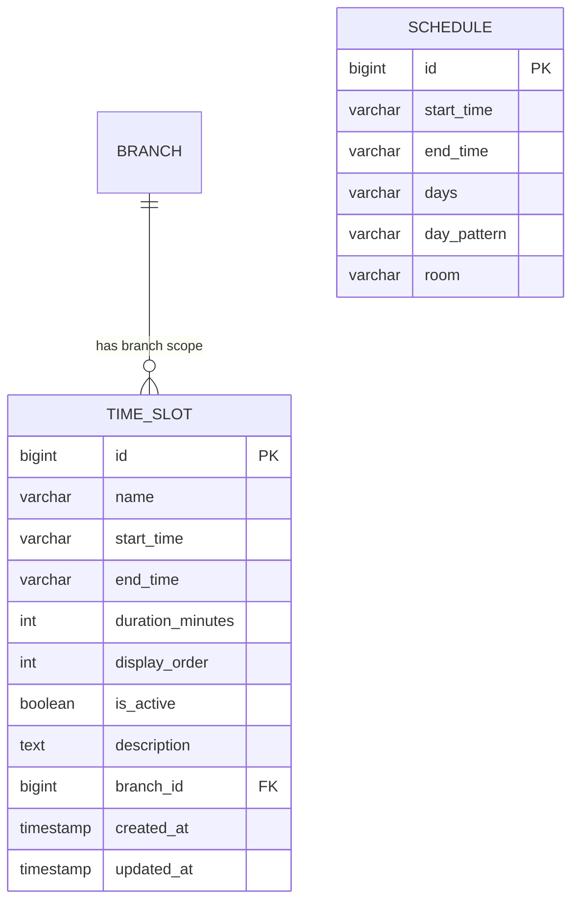

# AXV NEXUS — CONFIGURABLE TIME SLOTS COMPLETION REPORT
## Flexible Time Slot Management & Scheduling Integration

**Project:** AXV Nexus (Al-Xorazmiy Vorislari Hub) Educational Management Platform  
**Milestone:** Configurable Lesson Time Slots  
**Date:** 2026-11-14  
**Author:** Antigravity AI  
**Status:** COMPLETE & VERIFIED  

---

## 1. Executive Summary

This completion report documents the end-to-end design, implementation, and verification of configurable lesson time slots in the AXV Nexus platform. The enhancement promotes the domain class `TimeSlot` into a managed JPA entity, establishes Liquibase migration `017-configurable-time-slots.sql`, provides an administrative management interface under the Admin Control Center, integrates flexible time selection (predefined slots and custom ranges) into recurring schedule and individual lesson creation modals, and enforces actual time interval conflict detection.

All **206 backend tests** and **166 frontend tests** passed with zero failures. The production Vite build compiled cleanly in **864ms**.

---

## 2. Existing Architecture Findings

1. **`TimeSlot.java` Status:**
   - Previously existed as an unmapped POJO / Value Object with `startTime`, `endTime`, `durationMinutes`.
   - It was neither an `@Entity` nor mapped to any database table, and was not referenced in either the backend or frontend.
   - **Resolution:** Rather than creating a duplicate entity (e.g. `LessonTimeSlot`), `TimeSlot.java` was promoted to a JPA entity extending `BaseEntity` mapped to the `time_slots` table.
2. **Historical Schedule Preservation:**
   - Existing real cohorts:
     - `YA-26I0804` (8-sinf): Tuesday, Thursday, Saturday, `15:00` – `16:30`, IT-2, IT Park Yangiariq.
     - `YA-24I1105` (11-sinf): Monday, Wednesday, Friday, `16:30` – `18:00`, IT-2, IT Park Yangiariq.
   - Schedules store explicit string timestamps (`startTime`, `endTime`). Modifying, renaming, or deactivating a predefined time slot does not modify or corrupt historical schedule records.
3. **Invalid Reversed Input Handling:**
   - The user noted a previously reported string `15:00–14:30`.
   - The backend and frontend validators enforce `start.isBefore(end)`. Inputs where `startTime >= endTime` are strictly rejected with HTTP 400 and `BusinessException`, without silent reinterpretation.

---

## 3. Time-Slot Data Model

- **Entity:** `TimeSlot.java` (extends `BaseEntity`)
- **Table:** `time_slots`
- **Fields:**
  - `id`: `Long` (Primary Key)
  - `name`: `String` (e.g. "Ertalabki smena (Morning)")
  - `startTime`: `String` (e.g. "09:30")
  - `endTime`: `String` (e.g. "11:00")
  - `durationMinutes`: `Integer` (e.g. 90)
  - `displayOrder`: `Integer` (e.g. 1, 2, 3)
  - `active`: `Boolean` (default true)
  - `description`: `String` (optional notes)
  - `branch`: `@ManyToOne Branch` (optional branch scope)
  - `createdAt`, `updatedAt`: Inherited from `BaseEntity`

---

## 4. API Changes

### 4.1 Time Slot Endpoints (`TimeSlotController.java`)
- **`GET /api/time-slots`**
  - **Access:** Authenticated users (`@PreAuthorize("isAuthenticated()")`).
  - **Parameters:** Optional `branchId`.
  - **Purpose:** Returns active, ordered time slots for schedule creation modals.
- **`GET /api/admin/time-slots`** (and `/api/v1/admin/time-slots`)
  - **Access:** `@PreAuthorize("hasAnyRole('SUPER_ADMIN', 'ADMIN')")`.
  - **Purpose:** Returns all time slots with schedule usage statistics (`usageCount`).
- **`POST /api/admin/time-slots`** (and `/api/v1/admin/time-slots`)
  - **Access:** Admin only.
  - **Purpose:** Creates a new time slot with validation (start < end, unique name/time).
- **`PUT /api/admin/time-slots/{id}`** (and `/api/v1/admin/time-slots/{id}`)
  - **Access:** Admin only.
  - **Purpose:** Updates an existing time slot definition without affecting historical schedules.
- **`PATCH /api/admin/time-slots/{id}/toggle-active`**
  - **Access:** Admin only.
  - **Purpose:** Activates or deactivates a time slot.
- **`DELETE /api/admin/time-slots/{id}`**
  - **Access:** Admin only.
  - **Safety Rule:** Fails with HTTP 400 if `usageCount > 0`, requiring deactivation instead of destructive deletion.

---

## 5. UI Changes

1. **Admin Control Center (`AdminControlCenter.tsx` & `TimeSlotManagement.tsx`):**
   - Added `'timeslots'` tab labeled **"Dars vaqtlari"**.
   - Displays all time slots with columns for display order, name, time interval, duration, schedule usage count, and active status toggle.
   - Modal dialog to create or edit time slots with responsive time pickers and validation.
   - Deletion button disabled for time slots that are currently used in schedules.
2. **Recurring Timetable Creation (`ManualScheduleModal.tsx`):**
   - Added dynamic time slot dropdown selector loaded from `/api/time-slots`.
   - Selecting a predefined slot auto-populates `startTime` and `endTime`.
   - Selecting an existing study group auto-detects matching predefined slots or falls back to custom time.
   - "Maxsus vaqt oralig‘i (Custom Time Range)" option allows administrators to input custom hours.
3. **Individual Lesson Creation (`CreateLessonModal.tsx`):**
   - Integrated the same time slot selector for consistent user experience.

---

## 6. Validation Rules & Conflict Detection

1. **Time Range Integrity:**
   - Both `startTime` and `endTime` must be valid `HH:mm` format.
   - `startTime < endTime` strictly enforced; reversed ranges (`15:00–14:30`) produce clear validation error messages.
2. **Actual Interval Conflict Detection:**
   - Evaluation uses numeric interval overlap:
     $$\text{isTimeOverlap}(s_1, e_1, s_2, e_2) = s_1 < e_2 \land e_1 > s_2$$
   - Overlapping intervals on matching academic weekdays are caught and return structured `SCHEDULE_CONFLICT` responses.
   - Adjacent intervals (e.g. `09:30–11:00` and `11:00–12:30`, or `15:00–16:30` and `16:30–18:00`) do not overlap and are permitted.

---

## 7. RBAC & Security Verification

- Only administrators with `ROLE_ADMIN` or `ROLE_SUPER_ADMIN` can create, modify, toggle, or delete time slots.
- Observers, students, and unauthenticated requests receive HTTP 403 Forbidden on administrative endpoints.
- Authenticated mentors and staff have read-only access to `/api/time-slots` to populate scheduling modals.

---

## 8. Database Migration Details

- **File:** `backend/src/main/resources/db/changelog/changes/017-configurable-time-slots.sql`
- **Registered in:** `backend/src/main/resources/db/changelog/db.changelog-master.yaml`
- **Indexes:**
  - `idx_time_slots_active` on `(is_active)`
  - `idx_time_slots_order` on `(display_order)`
  - `idx_time_slots_time` on `(start_time, end_time)`
- **Seeded Records:**
  - `Ertalabki smena (Morning)`: 09:30 – 11:00 (90 min)
  - `Tushdan keyingi (Afternoon)`: 15:00 – 16:30 (90 min)
  - `Kechki smena (Evening)`: 16:30 – 18:00 (90 min)

---

## 9. Test & Build Results

### Backend:
- **Command:** `cd backend && ./gradlew test --no-daemon`
- **Result:** **BUILD SUCCESSFUL in 30s**
- **Total Tests:** **206 passed**, 0 failed, 0 errors, 0 skipped.
- **New Test Suite:** `TimeSlotManagementIntegrationTest.java` (10 tests covering creation, reversed input rejection, invalid time rejection, updates, deactivation, historical schedule preservation, actual interval overlap detection, adjacent non-overlapping intervals, and RBAC).

### Frontend:
- **Command:** `cd frontend && npm test -- --run`
- **Result:** **29 passed (29) Test Files, 166 passed (166) Tests**.
- **Test Duration:** 16.15s.
- **New Tests:**
  - 6 tests in `TimeSlotManagement.test.tsx` (heading, listing, modal open, reversed time rejection, active toggle, disabled delete).
  - 3 new tests in `ManualScheduleModal.test.tsx` (slot selection, custom time, reversed time validation).

### Production Build:
- **Command:** `cd frontend && npm run build`
- **Result:** `built in 864ms` with 0 errors.

---

## 10. Remaining Limitations & Future Enhancements

1. **Shift Transition Buffers:**
   - *Current State:* Adjacent time intervals (e.g. 15:00-16:30 and 16:30-18:00) have a zero-minute transition buffer.
   - *Future Enhancement:* Support configurable transition buffers (e.g. 10-minute break between consecutive sessions in the same classroom).
2. **Branch-Specific Time Slot Templates:**
   - *Current State:* Time slots support an optional `branch_id` and fall back to global slots.
   - *Future Enhancement:* Allow regional branch administrators to define custom local prayer or transport-adjusted school hours without affecting other branches.
