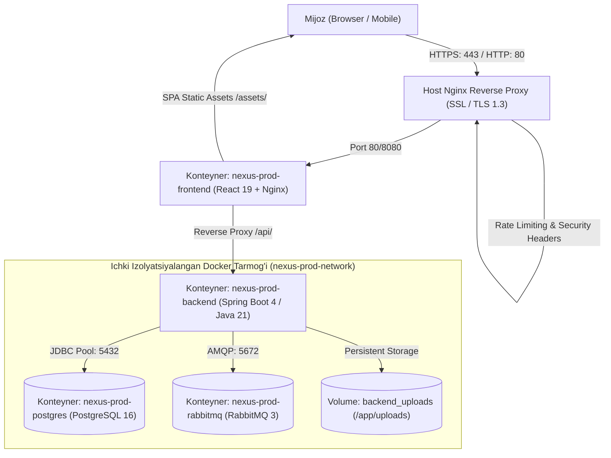

# AXM Nexus — Real Linux Server Deployment Qo‘llanmasi

Ushbu qo‘llanma **AXM Nexus** (Muhammad Al-Xorazmiy Vorislari platformasi) ta'lim tizimini real Linux serverga (Ubuntu 22.04/24.04 LTS yoki Debian 12 VPS/Dedicated server) xavfsiz, ishonchli va professional tarzda o‘rnatish bo‘yicha to‘liq amaliy yo‘riqnomadir.

---

## 1. Arxitektura va Ishlash Tamoyili

Real serverda loyiha quyidagi tarmoq va xizmatlar sxemasida ishlaydi:



### Xavfsizlik ustunliklari:
1. **Izolyatsiya**: PostgreSQL va RabbitMQ tashqi internetga ochilmaydi; faqat ichki Docker tarmog‘ida backend bilan bog‘lanadi.
2. **Non-Root**: Ham backend (`spring`), ham frontend (`nginx`) root bo‘lmagan xavfsiz foydalanuvchi huquqida ishlaydi.
3. **Doimiylik**: Ma'lumotlar bazasi (`postgres_prod_data`), navbat holati (`rabbitmq_prod_data`) va o‘quv resurslari (`backend_uploads`) server diskidagi Docker volumelarda saqlanadi.

---

## 2. Server va Uskunalar Talablari

| Resurs | Minimal Talab | Tavsiya etiladigan (Production) |
|---|---|---|
| **Operatsion Tizim** | Ubuntu 22.04 LTS / Debian 12 | Ubuntu 24.04 LTS 64-bit |
| **Protsessor (vCPU)** | 2 vCPU | 4 vCPU |
| **Operativ Xotira (RAM)**| 4 GB (+ 2GB Swap) | 8 GB RAM |
| **Disk (SSD/NVMe)** | 40 GB SSD | 80+ GB NVMe SSD |
| **Tarmoq** | 100 Mbps, 1 ta Statik Ochiq IP | 1 Gbps, Statik IP |
| **Domen (DNS)** | A-record server IP ga yo'naltirilgan domen (masalan, `axm-nexus.uz`) |

---

## 3. Domen va DNS Sozlamalari

Serverga ulanishdan oldin domeningiz DNS boshqaruv panelida (Cloudflare, Reg.uz yoki provayderingizda) quyidagi yozuvlarni kiriting:

```text
Type    Name    IPv4 Address        TTL
A       @       194.xxx.xxx.xxx     Auto / 300s
A       www     194.xxx.xxx.xxx     Auto / 300s
```

---

## 4. Tezkor Avtomatlashtirilgan O‘rnatish (Tavsiya Etiladi)

### 1-qadam: Serverga SSH orqali ulanish va kodni klonlash
```bash
ssh root@SERVER_IP

# Loyiha papkasini yaratish va klonlash
mkdir -p /opt/axvhub
cd /opt/axvhub
git clone https://github.com/izzatbek03/axvhub.git .
```

### 2-qadam: Server muhitini avtomatik tayyorlash
Skript Docker, Docker Compose, UFW Firewall (faqat 22, 80, 443 portlar ochiq), Fail2ban, Nginx va kerak bo‘lsa 2GB Swap yaratadi:
```bash
sudo bash scripts/setup-server.sh
```

### 3-qadam: Muhit faylini (`.env`) xavfsiz yaratish
```bash
cp .env.production.example .env
chmod 600 .env
nano .env
```

Quyidagi maxfiy kalitlarni yaratib `.env` ga yozing:
```bash
# 1. JWT Maxfiy Kaliti (kamida 64 belgili hex):
openssl rand -hex 32

# 2. Baza va RabbitMQ parollari:
openssl rand -base64 24
```

`.env` ichidagi eng muhim parametrlar:
```dotenv
SPRING_PROFILES_ACTIVE=prod
HTTP_PORT=80
POSTGRES_DB=axvhub
POSTGRES_USER=axm_admin
POSTGRES_PASSWORD=<generatsiya_qilingan_parol>
RABBITMQ_USER=nexus_mq_user
RABBITMQ_PASSWORD=<generatsiya_qilingan_parol>
APP_JWT_SECRET=<generatsiya_qilingan_jwt_kalit>
APP_BASE_URL=https://axm-nexus.uz
CORS_ALLOWED_ORIGINS=https://axm-nexus.uz,https://www.axm-nexus.uz
SUPER_ADMIN_BOOTSTRAP_ENABLED=true
SUPER_ADMIN_BOOTSTRAP_USERNAME=superadmin
SUPER_ADMIN_BOOTSTRAP_PASSWORD=NexusAdmin2026!#Strong
SUPER_ADMIN_BOOTSTRAP_EMAIL=admin@axm-nexus.uz
```

> [!IMPORTANT]
> `SUPER_ADMIN_BOOTSTRAP_PASSWORD` kamida 12 ta belgidan iborat bo‘lib, katta harf, kichik harf, son va maxsus belgi (`!@#$%^&*`) o‘z ichiga olishi shart.

### 4-qadam: Let's Encrypt SSL/TLS sertifikatini olish
```bash
sudo bash scripts/init-ssl.sh axm-nexus.uz admin@axm-nexus.uz
```
Ushbu skript:
- Let's Encrypt orqali bepul xalqaro SSL sertifikatini oladi.
- Host Nginx konfiguratsiyasiga ulaydi.
- Avtomatik yangilanish (auto-renew) uchun kunlik cron vazifasini o‘rnatadi.

### 5-qadam: Loyihani ishga tushirish (Deploy)
```bash
bash scripts/deploy.sh
```
Skript quyidagilarni amalga oshiradi:
1. `.env` fayli va xavfsizlik mezonlarini tekshiradi (`ProductionSecurityValidator` talablari).
2. Docker tasvirlarini multi-stage build orqali yig‘adi.
3. PostgreSQL va RabbitMQ ni ishga tushirib, ularning salomat holatga kelishini kutadi.
4. Backend (Spring Boot) ni ishga tushiradi va 22 ta Liquibase migratsiyasini avtomatik qo‘llaydi.
5. Frontend (React + Nginx) ni ishga tushiradi va salomatlik holatini tekshiradi.

### 6-qadam: Avtomatik yuklanish (Systemd Service) faollashtirish
Server qayta yuklanganda (reboot) loyiha avtomatik ravishda uzilishlarsiz ko‘tarilishi uchun:
```bash
sudo cp scripts/axm-nexus.service /etc/systemd/system/
sudo systemctl daemon-reload
sudo systemctl enable axm-nexus
sudo systemctl status axm-nexus
```

---

## 5. Boshlang‘ich Tizimga Kirish va SuperAdmin Sozlash

1. Brauzeringizda domeningizni oching: `https://axm-nexus.uz`
2. Kirish sahifasida `.env` faylida ko‘rsatilgan boshlang‘ich hisob orqali kiring:
   - **Login**: `superadmin`
   - **Parol**: `.env` dagi `SUPER_ADMIN_BOOTSTRAP_PASSWORD`
3. Muvaffaqiyatli kirgach, xavfsizlik maqsadida `.env` faylida bootstrapni o‘chirib qo‘ying:
   ```bash
   sed -i 's/SUPER_ADMIN_BOOTSTRAP_ENABLED=true/SUPER_ADMIN_BOOTSTRAP_ENABLED=false/' .env
   ```
   *(Eslatma: Tizim qayta bootstrap qilishni avtomatik ravishda bloklaydi, lekin o‘chirib qo‘yish tavsiya etiladi).*

---

## 6. Ma'lumotlar Bazasi Zaxiralash va Qayta Tiklash

### 6.1. Avtomatik Kundalik Zaxira (Cron)
Skript zaxirani siqilgan holda (`.sql.gz`) saqlaydi va 14 kundan eski fayllarni avtomatik tozalaydi.
```bash
# Qo'lda sinab ko'rish:
bash scripts/backup.sh

# Avtomatlashtirish (Har kecha soat 02:00 da):
(crontab -l 2>/dev/null; echo "0 2 * * * cd /opt/axvhub && bash scripts/backup.sh >> /var/log/nexus/backup.log 2>&1") | crontab -
```

### 6.2. Bazani Qayta Tiklash (Disaster Recovery)
Kutilmagan nosozlik yuz berganda avvalgi zaxiradan xavfsiz qayta tiklash:
```bash
# Mavjud zaxiralarni ko'rish va tiklash:
bash scripts/restore.sh
```
Skript tiklashdan avval joriy holatdan favqulodda xavfsizlik zaxirasi oladi, backendni to‘xtatadi, bazani tiklaydi va backendni qayta ishga tushiradi.

---

## 7. Loyihani Keyingi Yangilanishlarini Deploy Qilish (Updates)

Git orqali yangi o‘zgarishlar kiritilganda serverda yangilash juda oson:

```bash
cd /opt/axvhub
git pull origin main
bash scripts/deploy.sh
```

---

## 8. Monitoring va Foydali Buyruqlar

```bash
# Barcha konteynerlar holatini ko'rish
docker compose -f docker-compose.prod.yml ps

# Jonli loglarni kuzatish (Backend)
docker compose -f docker-compose.prod.yml logs -f backend

# Jonli loglarni kuzatish (Nginx / Frontend)
docker compose -f docker-compose.prod.yml logs -f frontend

# Resurslar sarfini real vaqtda ko'rish
docker stats

# Salomatlik endpointlarini tekshirish
curl -I https://axm-nexus.uz/healthz
curl -s http://localhost:8080/actuator/health | jq .
```

---

## 9. Xavfsizlik bo‘yicha Qo‘shimcha Tekshiruv Ro‘yxati (Checklist)

- [x] **Root-bo‘lmagan konteynerlar**: Backend `spring:spring`, Frontend `nginx:nginx`.
- [x] **50MB Fayl Yuklash Mosligi**: Nginx `client_max_body_size 50M`, Spring Multipart 50MB, doimiy `backend_uploads` volumeda.
- [x] **Xavfsiz Tarmoq**: Baza va RabbitMQ portlari faqat ichki tarmoqda, tashqaridan to‘siq.
- [x] **UFW Firewall**: Faqat 22 (SSH), 80 (HTTP), 443 (HTTPS) ochiq.
- [x] **Brute-Force Himoyasi**: Nginx orqali `/api/auth/login` so‘rovlariga qat'iy rate limiting o‘rnatilgan.
- [x] **Zero-Trust JWT**: Kamida 256-bitli tasodifiy kalit, placeholderlar taqiqlangan.
- [x] **HTTPS & HSTS**: Let's Encrypt SSL, A+ darajali xavfsizlik sarlavhalari.
