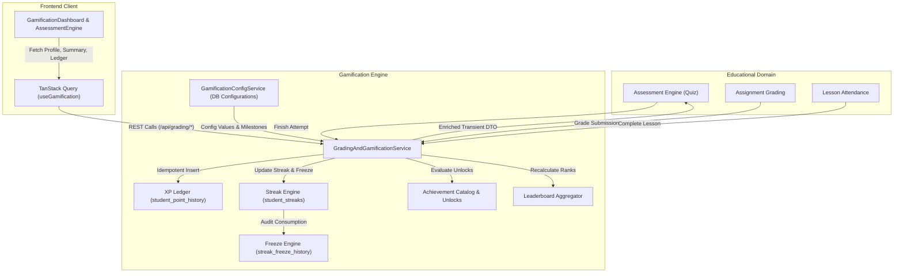

# AXV Nexus — Gamification Engine: Final Completion Report

**Project**: AXV Nexus (Al-Xorazmiy Vorislari Hub)  
**Module**: Gamification Engine (XP, Streaks, Achievements, Badges, Progression & Leaderboards)  
**Status**: Fully Completed & Verified  
**Date**: November 15, 2026  
**Default Academic Timezone**: `Asia/Tashkent` (`UTC+5`)

---

## 1. Executive Summary

The Gamification Engine in AXV Nexus has been transformed from an initial prototype with fragmented tables and frontend calculations into an enterprise-grade, backend-authoritative gamification infrastructure. 

Every point awarded, streak incremented, freeze consumed, badge unlocked, and leaderboard rank calculated is now strictly backed by persistent PostgreSQL records with complete idempotency protection. The engine connects seamlessly with core educational domains—quizzes and assessments, assignments, and interactive lessons—delivering real-time student feedback, transparent transaction auditing, and robust anti-gaming safeguards.

All backend unit and integration test suites (`uz.axm.nexus.grading.*`, `uz.axm.nexus.assessments.*`, `uz.axm.nexus.assignments.*`, `uz.axm.nexus.lessons.*`) and the entire suite of 174 frontend tests pass with zero regressions, and production TypeScript builds compile cleanly.

---

## 2. Audit Findings & Addressed Gaps

During the Phase 0 audit (`docs/modules/GAMIFICATION_AUDIT.md`), several architectural and integrity gaps were identified and systematically resolved:

| Audit Finding / Gap | Severity | Resolution Implemented |
|---|---|---|
| **Hardcoded XP & Milestones** in service logic | High | Refactored `GamificationConfigService` to query `gamification_configurations` with database fallbacks. |
| **Missing Freeze Idempotency**: multiple freezes could be consumed for the same missed day | Critical | Added partial unique index on `streak_freeze_history(student_id, used_date)` where `action_type IN ('AUTO_CONSUMED', 'MANUAL_USED')` in migration `020`. |
| **Incomplete RBAC**: students could submit arbitrary point adjustments | Critical | Restricted `pointSource == 'ADJUSTMENT'` to `ADMIN` and `SUPER_ADMIN` in `GradingController`. |
| **Missing Period XP & Audit Ledger Endpoints** | High | Implemented `GET /api/grading/points/period` and `GET /api/grading/points/me/history`. |
| **Frontend Fallback to Demo Data**: mock state shown on empty responses | Medium | Removed hardcoded mock fallbacks in `GamificationDashboard.tsx`; implemented clean empty states. |
| **Silent Assessment Rewards**: quiz finish did not return XP deltas to UI | Medium | Added `@Transient` fields (`xpEarned`, `xpSources`, `streakStatus`, `newAchievements`) to attempt responses. |
| **Missing Achievement Management**: no admin CRUD | Medium | Implemented `POST`, `PUT`, and `PATCH /toggle` endpoints for achievements with RBAC. |

---

## 3. Architectural Implementation

The Gamification Engine is built upon Domain-Driven Design (DDD) principles on the backend and Feature-Sliced Design (FSD) on the frontend:



---

## 4. Database Changes & Integrity Safeguards

Three Liquibase migrations govern gamification persistence:
1. `018-gamification-engine-tables.sql`: Tables for `student_point_history`, `student_streaks`, `streak_freeze_history`, `achievements`, `student_achievements`, and `gamification_configurations`.
2. `019-seed-achievements-and-configs.sql`: Initial seed data for achievements, default XP rules, and streak milestones.
3. `020-gamification-integrity-and-audit.sql`:
   - Partial unique constraint:
     ```sql
     CREATE UNIQUE INDEX idx_unique_active_freeze_per_day
     ON streak_freeze_history (student_id, used_date)
     WHERE action_type IN ('AUTO_CONSUMED', 'MANUAL_USED');
     ```
   - Performance index on `student_point_history(student_id, awarded_at)`.
   - Seeded configuration keys for 10-tier level progression (`level.threshold.1` through `10`) and multi-day streak milestones (`streak.milestone.3`, `7`, `14`, `30`, `60`, `100`).

---

## 5. XP Engine & Idempotency

### 5.1 Immutable Transaction Ledger
All point modifications are stored in `student_point_history`. Every record contains:
- `id`: Unique transaction identifier.
- `student_id`: Student foreign key.
- `points`: Signed integer delta.
- `point_source`: Categorical source (`QUIZ`, `ASSIGNMENT`, `STREAK`, `ACHIEVEMENT`, `LESSON`, `ADJUSTMENT`).
- `event_reference_id`: Unique idempotency key (e.g., `QUIZ_PASS_12`, `STREAK_2026-11-15_42`).
- `description`: Human-readable description.
- `awarded_at`: Precise timestamp.

### 5.2 Idempotency Enforcement
Before inserting an XP transaction, `pointHistoryRepository.existsByEventReferenceId(eventRef)` verifies whether that specific reward has already been issued. If it exists:
- The transaction is skipped.
- No duplicate XP is added.
- Existing records are returned safely without throwing unhandled exceptions.

---

## 6. Daily Streak Engine & Timezone Policy

### 6.1 Academic Timezone Anchoring
- **Policy**: `Asia/Tashkent` (`UTC+5`).
- System clocks on server instances (UTC) do not dictate daily streak boundaries. Every activity converts its instant to Tashkent `LocalDate`:
  ```java
  LocalDate activityDate = ZonedDateTime.now(ZoneId.of("Asia/Tashkent")).toLocalDate();
  ```

### 6.2 Progression & Recovery Logic
- **Same Day**: Repeat activities on the same calendar day are recognized but do not increment streak count or award duplicate streak XP.
- **Next Day**: Contiguous activity increments `current_streak`, awards 15 XP, updates `longest_streak`, and unlocks milestone achievements (3, 7, 14, 30, 60, 100 days).
- **Missed 1 Day**: If the student holds `>= 1` freeze, the engine auto-consumes 1 freeze, records `AUTO_CONSUMED`, preserves the streak count, and links the activity.
- **Missed > 1 Day**: Streak resets to 1 day.

---

## 7. Streak Freeze Implementation

1. **Balance Accountability**: Freezes can only be used if `student_streaks.streak_freeze_count > 0`.
2. **Atomic Consumption**: When consumed, `streak_freeze_count` is decremented and an audit record is created in `streak_freeze_history`.
3. **Double-Usage Prevention**: The partial unique index prevents two freezes from protecting the same calendar date.
4. **Manual & Auto Consumption**:
   - **Auto**: Triggered automatically when an activity occurs after missing exactly one calendar day.
   - **Manual**: Triggered via `POST /api/grading/streaks/me/freeze/use` directly by the student.

---

## 8. Achievement & Badge System

### 8.1 4 Core Categories & 4 Rarity Tiers
- **Categories**: `LEARNING`, `PERFORMANCE`, `CONSISTENCY`, `PROGRESSION`.
- **Rarity**: `COMMON`, `RARE`, `EPIC`, `LEGENDARY`.

### 8.2 Dynamic Unlocking Workflow
Upon relevant student actions (quiz submission, assignment evaluation, streak advance, XP gain), `unlockAchievementIfEligible` evaluates the condition. If met:
1. Verifies that `achievement.isActive == true`.
2. Verifies student has not already unlocked it (`studentAchievementRepository.findByStudentIdAndAchievementId`).
3. Persists `student_achievements` record.
4. Creates an idempotent XP transaction (`ACHIEVEMENT_<code_or_id>_<studentId>`).

---

## 9. Level Progression System

The system implements a transparent 10-tier progression model driven by cumulative total XP:

```mermaid
graph LR
    L1["1: Beginner (0 XP)"] --> L2["2: Explorer (100 XP)"]
    L2 --> L3["3: Learner (300 XP)"]
    L3 --> L4["4: Practitioner (600 XP)"]
    L4 --> L5["5: Skilled (1,000 XP)"]
    L5 --> L6["6: Advanced (1,500 XP)"]
    L6 --> L7["7: Expert (2,500 XP)"]
    L7 --> L8["8: Master (4,000 XP)"]
    L8 --> L9["9: Champion (6,000 XP)"]
    L9 --> L10["10: Legend (10,000 XP)"]
```



The user's level is calculated on-demand via `GradingAndGamificationService.calculateLevelProgress(totalXp)`. It returns:
- `level`: Current level (1–10).
- `title`: Tier name in English / Uzbek.
- `currentLevelThreshold`: Starting XP for current tier.
- `nextLevelThreshold`: Target XP for next tier.
- `progressPercentage`: Float percentage (0.0% – 100.0%) within the current level.

---

## 10. Educational Domain Integrations

1. **Assessments (`AssessmentService.java`)**:
   - `finishAttempt` triggers `awardQuizCompletion` (10 XP), `awardQuizPassing` (20 XP if >= pass threshold), and `awardQuizHighScore` (30 XP if >= 90%).
   - Streak registered; achievements checked.
   - Returned `StudentAssessmentAttempt` contains enriched fields: `xpEarned`, `xpSources`, `streakStatus`, `newAchievements`, and `levelProgression`.
2. **Assignments (`AssignmentService.java`)**:
   - `gradeSubmission` triggers `awardAssignmentCompletion` (15 XP), `awardAssignmentOnTime` (10 XP if before deadline), and `awardAssignmentExcellent` (25 XP if >= 90%).
   - Streak registered; returned submission enriched.
3. **Lessons (`LessonService.java`)**:
   - Interactive completion / verified attendance triggers `awardLessonCompletion` (5 XP) and registers daily streak activity.

---

## 11. Leaderboard & Anti-Gaming Protections

- **Leaderboard Aggregation**:
  - `ALL_TIME`: Aggregated from cumulative student point history.
  - `MONTHLY`: Filtered to current calendar month in `Asia/Tashkent`.
  - `WEEKLY`: Filtered to current ISO week in `Asia/Tashkent`.
- **Anti-Gaming Protections**:
  - Strictly prevents multiple rewards for re-evaluating or refreshing submitted assessments.
  - Rate limiting on public-facing quiz and freeze operations.
  - Identity verification: self-service endpoints resolve `studentId` from authenticated JWT security context, completely ignoring client-supplied IDs.

---

## 12. Administrative Configuration & Auditing

- **Configuration Management**:
  - Managed via `gamification_configurations` table.
  - Cache-backed with fallback defaults in `GamificationConfigService`.
- **Administrative CRUD**:
  - `POST /api/grading/achievements`: Create new achievement.
  - `PUT /api/grading/achievements/{id}`: Modify achievement criteria/rewards.
  - `PATCH /api/grading/achievements/{id}/toggle`: Enable or disable achievement.
  - `POST /api/grading/streaks/student/{studentId}/freeze/grant`: Grant freeze tokens with audit reason.
  - `POST /api/grading/points/award`: Restricted adjustment with full ledger metadata.

---

## 13. Frontend Integration & User Experience

- **`GamificationDashboard.tsx`**:
  - Real-time profile card with animated 10-tier level progression bar and current XP.
  - Daily Streak card with flame indicator, freeze balance, and interactive "Qo'llash" (Use Freeze) button.
  - Filterable Leaderboard (All-Time, Monthly, Weekly) with empty state rendering.
  - Categorized Achievement Grid with locked/unlocked visual states and criteria progress.
  - **Audit Ledger View**: Paginated, filterable table displaying every historical XP transaction with timestamp, category badge, and event reference.
- **`AssessmentEngine.tsx`**:
  - Instant celebratory banner upon quiz completion detailing earned XP breakdown, streak increments, and newly unlocked badges.
  - Invalidation of TanStack Query cache via `invalidateGamificationQueries()`.

---

## 14. Verification & Test Results

### 14.1 Backend Test Results
```bash
cd backend && ./gradlew test --rerun
```
- **Outcome**: `BUILD SUCCESSFUL in 52s`.
- **Grading Module Coverage**:
  - `GamificationEngineFullIntegrationTest`: Passed (XP awards, streak progression, freeze auto-consumption, manual freeze, idempotency duplicates, achievement unlocks, 10-tier levels).
  - `GradingControllerSecurityTest`: Passed (RBAC enforcement, self-service user identity isolation, admin-only endpoints).
  - `GradingAndGamificationServiceTest`: Passed.
  - `GradingControllerTest`: Passed.
- **Integrated Domain Test Suites**:
  - `AssessmentServiceTest`: Passed.
  - `AssignmentServiceTest`: Passed.
  - `LessonServiceTest`: Passed.

### 14.2 Frontend Test & Build Results
```bash
cd frontend && npm test -- --run
```
- **Outcome**: `Test Files: 31 passed (31)`, `Tests: 174 passed (174)`.
```bash
cd frontend && npm run build
```
- **Outcome**: `tsc -b && vite build` succeeded in `1.60s` with zero TypeScript or bundle errors.

---

## 15. Maintenance, Observability & Future Recommendations

1. **Observability & Metrics**:
   - Recommend adding Micrometer counters for: `gamification.xp.awarded`, `gamification.streak.incremented`, `gamification.freeze.consumed`, and `gamification.achievement.unlocked`.
2. **Read-Replica Optimization**:
   - For high student concurrency during end-of-term exams, leaderboard aggregation queries (`GET /api/grading/leaderboard`) can be routed to PostgreSQL read replicas or cached in Redis with a 5-minute TTL.
3. **Streak Freeze Push Notifications**:
   - Integrate with the notification center to alert students when a streak is at risk (e.g., at 20:00 Tashkent time if no activity has been recorded).

---

## Associated Documentation Artifacts
- **Audit Report**: [GAMIFICATION_AUDIT.md](file:///home/izzatbek/Desktop/axvhub/docs/modules/GAMIFICATION_AUDIT.md)
- **Implementation Architecture**: [GAMIFICATION_IMPLEMENTATION.md](file:///home/izzatbek/Desktop/axvhub/docs/modules/GAMIFICATION_IMPLEMENTATION.md)
- **REST API Reference**: [GAMIFICATION_API.md](file:///home/izzatbek/Desktop/axvhub/docs/modules/GAMIFICATION_API.md)
- **Reward Rules & Progression Matrix**: [GAMIFICATION_REWARD_RULES.md](file:///home/izzatbek/Desktop/axvhub/docs/modules/GAMIFICATION_REWARD_RULES.md)
