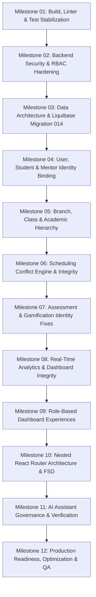

# AXM Nexus — Phased Implementation Roadmap
**Muhammad al-Xorazmiy Vorislari Digital Education Management Platform**

This roadmap defines the prioritized, milestone-driven execution plan to transform AXM Nexus into a secure, production-ready educational management ecosystem.

---

## Roadmap Overview

---

## Milestone 01: Build Health, Linter & Test Stabilization
**Priority:** **CRITICAL** | **Focus:** Restoring CI/CD green state and baseline quality.

### Objectives
1. Fix the TypeScript compile failure in `RichTextRenderer.tsx`.
2. Fix 17 ESLint errors in `defaultLessonsData.ts`, `AssessmentEngine.tsx`, and `AttendanceCalendar.tsx`.
3. Fix the failing Vitest test in `Modules08To11.test.tsx` (line 340).
4. Remove dead prototype classes (`Material`, `Submission`, `Grade`, `GradingService`).

### Affected Files
- `frontend/src/components/lessons/RichTextRenderer.tsx`
- `frontend/src/components/lessons/defaultLessonsData.ts`
- `frontend/src/components/assessments/AssessmentEngine.tsx`
- `frontend/src/components/attendance/AttendanceCalendar.tsx`
- `frontend/src/components/__tests__/Modules08To11.test.tsx`
- `backend/src/main/java/uz/axm/nexus/materials/` (remove dead classes)
- `backend/src/main/java/uz/axm/nexus/assignments/domain/Submission.java` (remove dead class)
- `backend/src/main/java/uz/axm/nexus/grading/application/GradingService.java` (remove dead class)

### Acceptance Criteria
- `cd frontend && npm run build` exits with code 0 (0 TypeScript errors).
- `cd frontend && npm run lint` passes with 0 errors.
- `cd frontend && npx vitest run` passes with 24/24 test suites and 130/130 tests passing.
- `cd backend && ./gradlew test` passes 100%.

---

## Milestone 02: Backend Security & RBAC Hardening
**Priority:** **CRITICAL** | **Focus:** Closing open endpoints, eliminating header spoofing, enforcing JWT RBAC.

### Objectives
1. Update `SecurityConfig.java`: Replace `.anyRequest().permitAll()` with `.anyRequest().authenticated()`.
2. Remove spoofable headers (`X-Admin-User`, `X-User-Role`, `X-User-Id`, `X-Mentor-Id`) across all controllers and services.
3. Update `CurrentUserHelper.java`: Eliminate default `1L` fallback; throw `AccessDeniedException` if unauthenticated.
4. Add `@PreAuthorize("hasAuthority('...')")` annotations across:
   - `StudentController.java` (`student:read`, `student:create`, `student:update`, `student:delete`)
   - `MentorController.java` (`mentor:read`, `mentor:create`, `mentor:update`)
   - `StudyGroupController.java` (`group:read`, `group:create`, `group:update`)
   - `LessonAttendanceController.java` (`attendance:read`, `attendance:record`, `lesson:create`, `lesson:update`)
   - `AiAssistantController.java` (`ai:prompt`, `lesson:create`, `assessment:create`)
   - `CurriculumController.java` (`curriculum:read`)
5. Standardize API URL routes under `/api/v1/` with backward-compatible aliases for legacy routes.

### Acceptance Criteria
- Unauthenticated requests to `/api/students`, `/api/mentors`, `/api/groups`, `/api/lessons` return `401 UNAUTHORIZED`.
- Requests with spoofed `X-Admin-User: admin` headers without valid JWT return `401 UNAUTHORIZED`.
- Authenticated users without required permissions return `403 FORBIDDEN`.

---

## Milestone 03: Data Architecture & Liquibase Migration 014
**Priority:** **HIGH** | **Focus:** Structural schema fixes, referential integrity, and multi-branch readiness.

### Objectives
1. Create Liquibase migration `014-structural-fixes-and-academic-hierarchy.sql`.
2. Add `user_id BIGINT UNIQUE REFERENCES users(id)` to `students` table.
3. Fix `student_learning_outcome_evaluations` foreign key to reference `students(id)` instead of `users(id)`.
4. Create `branches` table and link `study_groups.branch_id`, `rooms.branch_id`, `mentors.branch_id`, `students.branch_id`.
5. Create `subjects` table and seed curriculum tracks into the database.
6. Add database unique constraints and performance indexes for room and schedule queries.

### Acceptance Criteria
- Liquibase migration runs cleanly on both PostgreSQL and H2 in-memory databases.
- `Student` entity maps `@OneToOne` or `@ManyToOne` to `User`.
- `student_learning_outcome_evaluations` successfully inserts evaluations using valid student IDs.

---

## Milestone 04: User, Student & Mentor Identity Binding
**Priority:** **HIGH** | **Focus:** Proper identity synchronization between auth accounts and academic profiles.

### Objectives
1. Update `StudentService.java`: When provisioning or saving a student, reliably populate `student.userId` and create the corresponding `User` account.
2. Provide `GET /api/v1/students/me` endpoint allowing logged-in students to fetch their own student profile directly.
3. Provide `GET /api/v1/mentors/me` endpoint allowing logged-in mentors to fetch their mentor profile and assigned groups directly.
4. Update frontend `useAuth()` to store the current user's associated `studentId` or `mentorId`.

### Acceptance Criteria
- Logged-in students can fetch their own student record without guessing PINFL or student IDs.
- Logged-in mentors can fetch their assigned groups without full table scans.

---

## Milestone 05: Branch, Class & Academic Management
**Priority:** **HIGH** | **Focus:** Multi-branch support, class management, and curriculum persistence.

### Objectives
1. Implement `BranchService`, `BranchRepository`, and `BranchController` (`/api/v1/branches`).
2. Implement branch-scoping logic: Regional and branch administrators can only view and manage records within their branch.
3. Implement `SubjectService` and replace hardcoded `SubjectTrack` in `EducationService` with real database records.
4. Add branch filtering across students, mentors, groups, and timetable views.

### Acceptance Criteria
- Administrators can manage multiple branches (starting with Yangiariq branch).
- Subjects can be managed dynamically via API.

---

## 6. Milestone 06: Scheduling Conflict Engine & Integrity
**Priority:** **HIGH** | **Focus:** Preventing room and mentor double-booking in both schedules and sessions.

### Objectives
1. Unify conflict checking across `ScheduleService` and `AttendanceScheduleService`.
2. Check for mentor and room collisions before creating or updating `Schedule` templates.
3. Implement an automatic generator that converts weekly `Schedule` templates into concrete `LessonSession` calendar instances for the semester.
4. Optimize `AttendanceScheduleService.getSessions()` to eliminate N+1 queries using grouped batch fetching.

### Acceptance Criteria
- Creating overlapping schedules for the same mentor or room throws a validated `BusinessException`.
- Fetching 50 calendar sessions executes at most 2 SQL queries instead of 100+.

---

## 7. Milestone 07: Assessment & Gamification Identity Fixes
**Priority:** **HIGH** | **Focus:** Connecting tests, assignments, streaks, and XP to the authentic student user.

### Objectives
1. Fix `AssessmentEngine.tsx`: Replace `activeStudentId = _students[0]?.id || 1` with the authenticated student's real ID.
2. Fix `GamificationDashboard.tsx`: Replace `activeStudentId = students[0]?.id || 1` with the authenticated student's real ID.
3. Secure `GradingController.java`: Ensure `/grades/student/{studentId}` only allows mentors/admins or the student themselves.
4. Ensure quiz submissions and daily check-ins update the actual user's XP, streak, and grade records.

### Acceptance Criteria
- Student A taking a test records the attempt under Student A's account.
- Daily check-in increments Student A's streak and awards XP to Student A only.

---

## 8. Milestone 08: Real-Time Analytics & Dashboard Integrity
**Priority:** **CRITICAL** | **Focus:** Removing all hardcoded and fabricated statistics.

### Objectives
1. Refactor `AdminDashboardView.tsx`:
   - Replace hardcoded `attendanceDays` array with real daily attendance trend data from `GET /api/v1/analytics/overview`.
   - Replace hardcoded `itLabs` array with live room utilization calculations from `lesson_sessions`.
   - Connect KPI cards to real server aggregations.
   - Add date-range picker (`7d`, `30d`, `semester`, custom).
   - Add branch filter dropdown.
   - Add navigable card clicks (clicking KPI navigates to filtered table).
   - Add loading skeletons and error retry state.
2. Refactor `MentorDashboardView.tsx`:
   - Connect next lesson card to `GET /api/lessons/today?mentorId=...`.
   - Connect attendance and groups to real mentor analytics.
3. Refactor `StudentDashboardView.tsx`:
   - Fetch real GPA, course progress, attendance rate, XP, and streak from backend.

### Acceptance Criteria
- Zero hardcoded numbers or percentages on all 3 dashboard views.
- Changing date range or branch updates all dashboard statistics dynamically.
- Skeletons display during loading, and error states display on network failure.

---

## 9. Milestone 09: Role-Based Dashboard Experiences
**Priority:** **MEDIUM** | **Focus:** Strict UX separation for Administrator, Mentor, and Student.

### Objectives
1. Enforce strict role views: Students see only their personal dashboard; mentors see only assigned groups; admins see branch/system view.
2. Disable client-side role switcher for non-admin accounts.
3. Ensure backend enforces authorization independently of frontend visibility.

### Acceptance Criteria
- A student logging in cannot switch to or view administrator or mentor dashboards.
- Direct API calls to administrative analytics return 403 Forbidden for students.

---

## 10. Milestone 10: Nested React Router Architecture & FSD Refinement
**Priority:** **MEDIUM** | **Focus:** Deep linking, browser navigation, and FSD layer organization.

### Objectives
1. Refactor `/app/*` in `frontend/src/app/App.tsx` from in-memory tab state to nested React Router routes:
   - `/app/dashboard`, `/app/timetable`, `/app/analytics`, `/app/lessons`, `/app/materials`, `/app/assessments`, `/app/grading`, `/app/groups`, `/app/students`, `/app/mentors`, `/app/users`, `/app/admin`, `/app/curriculum`, `/app/profile`.
2. Update `<AppShell>` and `<Sidebar>` to highlight active navigation items based on current URL path.
3. Move lazy data fetching into individual page components using TanStack React Query (`useQuery`).
4. Ensure browser back/forward buttons and page bookmarks work across all views.

### Acceptance Criteria
- Navigating to `/app/students` opens the students list directly.
- Refreshing the page preserves the current tab and filter parameters.

---

## 11. Milestone 11: AI Assistant Governance & Verification
**Priority:** **MEDIUM** | **Focus:** Permission-aware AI, draft transparency, and quota safety.

### Objectives
1. Add `@PreAuthorize` on all AI Assistant endpoints.
2. Inherit permissions from authenticated user rather than client headers.
3. Explicitly mark all AI-generated lessons and assessments as `DRAFT` requiring mentor review before publishing.
4. Replace simulated AI responses in `MockAiProviderAdapter` with clear offline template labeling.
5. Add rate-limiting per user to prevent quota exhaustion.

### Acceptance Criteria
- Unauthenticated AI requests are rejected.
- Students cannot generate administrative lesson plans.
- Generated content is visibly marked as "AI Draft - Verification Required".

---

## 12. Milestone 12: Production Readiness, Optimization & QA
**Priority:** **MEDIUM** | **Focus:** End-to-end verification, performance profiling, and deployment readiness.

### Objectives
1. Write backend unit and integration tests for new security rules, branch scoping, and conflict detection.
2. Write frontend component and route tests for all updated dashboards and nested routes.
3. Validate Docker Compose production build (`docker-compose.prod.yml`).
4. Verify database migration rollback safety and backup procedures.
5. Conduct full accessibility and localization check (Uzbek, Russian, English).

### Acceptance Criteria
- All backend tests pass (`./gradlew test`).
- All frontend tests pass (`npx vitest run`).
- Production build succeeds without warnings (`npm run build`).
- Docker containers spin up cleanly and pass `/actuator/health`.
