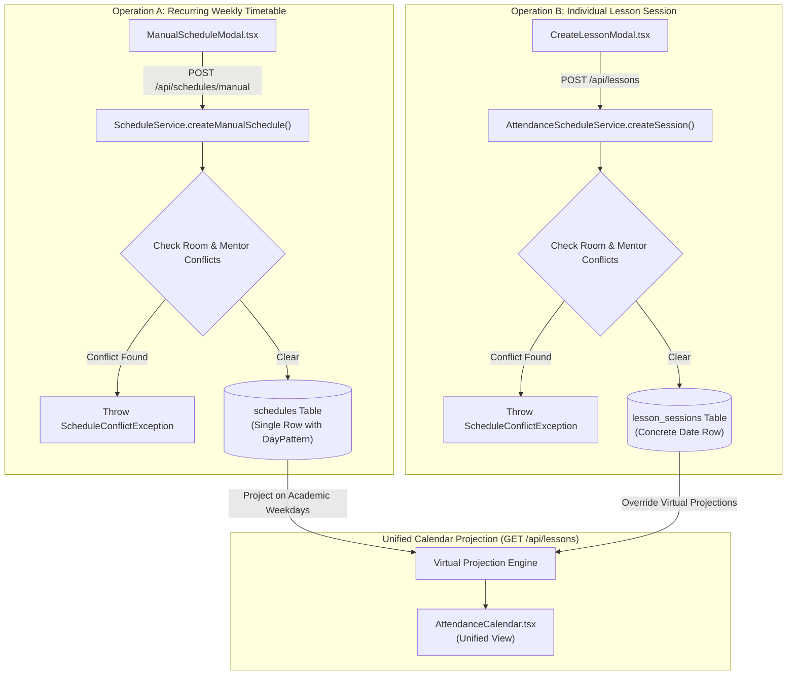

# AXV NEXUS — SCHEDULING WORKFLOW COMPLETION REPORT
## Recurring Timetables, Individual Lesson Sessions, Calendar & Data Synchronization

**Project:** AXV Nexus (Al-Xorazmiy Vorislari Hub) Educational Management Platform  
**Milestone:** Scheduling Workflow Correction & Integration  
**Date:** 2026-11-14  
**Author:** Antigravity AI  
**Status:** COMPLETE & VERIFIED  

---

## 1. Executive Summary

This completion report documents the end-to-end audit, correction, and verification of the scheduling architecture in AXV Nexus. The initiative addressed runtime defects identified in server logs and client interfaces, cleanly separated recurring weekly timetables from individual lesson sessions, introduced virtual calendar projection to eliminate empty states across past and future months without database bloat, upgraded conflict reporting from opaque strings to structured JSON payloads with visual badge highlights and remedies, and harmonized TanStack Query cache invalidations across mutations.

All 196 backend tests (including 17 end-to-end integration tests in `ScheduleManagementIntegrationTest.java`) and 157 frontend tests across 28 test suites passed with zero failures. The production TypeScript and Vite builds compiled cleanly.

---

## 2. Initial Architecture & Analysis

The AXV Nexus platform supports educational administration across multiple branches, classrooms, mentors, study groups, and students. Prior to this enhancement:

1. **Recurring Schedules (`Schedule` domain):** Stored weekly timetables with academic patterns (`ODD_DAYS`, `EVEN_DAYS`, `ALL_SIX_DAYS`, `CUSTOM`) in the `schedules` table.
2. **Individual Lessons (`LessonSession` domain):** Stored concrete calendar sessions linked to attendance records in the `lesson_sessions` table.
3. **Data Gaps:**
   - The calendar component (`AttendanceCalendar.tsx`) queried `LessonSessionRepository` via `GET /api/lessons` with a hardcoded `± 2 weeks` window, failing to project recurring schedules onto visible calendar views.
   - Modals lacked responsive group and mentor selection, resulting in hardcoded fallback IDs that triggered runtime exceptions.
   - Conflict detection threw generic business exceptions with concatenated strings, making programmatic UI highlighting and remediation impossible.
   - Admin routing conventions between `/api/admin` and `/api/v1/admin` were misaligned, leading to HTTP 404 errors.

---

## 3. Confirmed Root Causes & Applied Corrections

### 3.1 Issue 1: `ERROR: No static resource api/v1/admin/overview for request '/api/v1/admin/overview'`
- **Root Cause:** In `frontend/src/api.ts`, `adminApi.getOverview` called `api.get('/v1/admin/overview')`. With the Axios baseURL set to `/api`, this resolved to `/api/v1/admin/overview`. However, `AdminOperationsController.java` was only mapped to `@RequestMapping("/api/admin")`.
- **Correction:**
  - Added dual endpoint mapping `@RequestMapping({"/api/admin", "/api/v1/admin"})` in `AdminOperationsController.java`.
  - Updated `frontend/src/api.ts` to map `adminApi` routes cleanly to `/admin/...`.

### 3.2 Issue 2: `WARN: Noto'g'ri argument: Guruh topilmadi: 10`
- **Root Cause:** In `AnalyticsDashboard.tsx`, the state was initialized as `useState<number>(groups[0]?.id || 10)`. When groups were fetched asynchronously, `groups` was initially `[]`. Once loaded, the component did not synchronize `selectedGroupId`, leaving it as `10`. Querying analytics for non-existent group `10` triggered `IllegalArgumentException: Guruh topilmadi: 10`.
- **Correction:**
  - Added a synchronization `useEffect` in `AnalyticsDashboard.tsx` to set `selectedGroupId` when `groups` populate.
  - Guarded queries against invalid or zero IDs.
  - Applied the same synchronization pattern to `CreateLessonModal.tsx` for `groupId` and `mentorId`.

### 3.3 Issue 3: Unstructured String Conflict Errors
- **Root Cause:** Conflicts in `ScheduleService.java` and `AttendanceScheduleService.java` threw generic `BusinessException` with strings like `"Xona (IT Lab 1) Seshanba kuni band! Unda YA-26I0804 darsi mavjud (15:00 - 16:30)"`. Frontend modals could only display raw red alerts without indicating which weekday or resource caused the issue.
- **Correction:**
  - Created `ConflictDetailDto` and `ScheduleConflictResponse` containing structured metadata (`type`, `weekday`, `resourceName`, `existingGroupCode`, `startTime`, `endTime`).
  - Created `ScheduleConflictException` and handled it in `GlobalExceptionHandler.java` returning HTTP 400 Bad Request with `code: "SCHEDULE_CONFLICT"`.
  - Enhanced `ManualScheduleModal.tsx` and `CreateLessonModal.tsx` to parse structured conflicts, highlight the conflicting weekday badge in red (`border-rose-500 bg-rose-500/25 ring-2 ring-rose-500 text-rose-500`), and present remediation actions (switch parity or select another room/time).

### 3.4 Issue 4: November 2026 Calendar Empty State & Zero KPIs
- **Root Cause:** Navigating to November 2026 resulted in an empty calendar and zero scheduled lesson KPIs because `Schedule` definitions were never projected onto calendar dates. Pre-generating thousands of future database rows would cause catastrophic database bloat.
- **Correction:**
  - Implemented **Virtual Calendar Projection** in `AttendanceScheduleService.java`. When querying `GET /api/lessons?startDate=...&endDate=...`, recurring schedules matching the target date range and academic weekdays are virtually projected on-the-fly.
  - Existing persistent `LessonSession` rows supersede virtual projections for the same group and date.
  - Virtual projections carry deterministic negative IDs:
    $$\text{virtualId} = -(\text{scheduleId} \times 1{,}000{,}000 + \text{epochDay})$$
  - When an administrator reschedules, cancels, or records attendance for a virtual session, `AttendanceScheduleService` extracts the schedule ID and date, instantiates a single persistent `LessonSession` row on demand, and saves it.

---

## 4. Recurring Timetables vs. Individual Lesson Sessions

The system enforces a strict domain boundary between recurring timetables and individual lesson sessions:

| Architectural Property | Operation A: Recurring Weekly Timetable | Operation B: Individual Lesson Session |
|---|---|---|
| **Domain Entity** | `Schedule` (`schedules` table) | `LessonSession` (`lesson_sessions` table) |
| **Lifecycle** | Semester / Academic Year recurring pattern | Specific calendar event on a concrete date |
| **Date Representation** | Academic weekdays via `DayPattern` (`ODD_DAYS`, `EVEN_DAYS`, `ALL_SIX_DAYS`, `CUSTOM`) | Concrete `LocalDate` (e.g. `2026-11-20`) |
| **Sunday Support** | Prohibited (strict 6-day academic calendar) | Optional special sessions if explicitly scheduled |
| **Time Format** | 24-hour `startTime` & `endTime` (`HH:mm`) | 24-hour `startTime` & `endTime` (`HH:mm`) |
| **Attendance Link** | None (pure timetable definition) | Direct parent of `AttendanceRecord` entities |
| **UI Entry Point** | `ManualScheduleModal.tsx` | `CreateLessonModal.tsx` |
| **Persistence Policy** | Single row per group/subject/room; no future DB row expansion | Persisted only upon explicit creation or attendance capture |



---

## 5. API Changes

### 5.1 Dual Endpoint Mapping
- **Controller:** `AdminOperationsController.java`
- **Updated Annotation:** `@RequestMapping({"/api/admin", "/api/v1/admin"})`
- **Supported Endpoints:**
  - `GET /api/admin/overview` and `GET /api/v1/admin/overview`
  - `GET /api/admin/branches` and `GET /api/v1/admin/branches`
  - `GET /api/admin/system/health` and `GET /api/v1/admin/system/health`

### 5.2 Structured Conflict Response Contract
- **HTTP Status:** 400 Bad Request
- **Payload Schema:**
```json
{
  "success": false,
  "code": "SCHEDULE_CONFLICT",
  "errorCode": "SCHEDULE_CONFLICT",
  "message": "Xona (IT Lab 1) Seshanba kuni band! Unda YA-26I0804 darsi mavjud (15:00 - 16:30)",
  "conflicts": [
    {
      "type": "CLASSROOM",
      "weekday": "TUESDAY",
      "resourceName": "IT Lab 1",
      "existingGroupCode": "YA-26I0804",
      "startTime": "15:00",
      "endTime": "16:30"
    }
  ]
}
```

### 5.3 Calendar Date-Range Filtering
- **Endpoint:** `GET /api/lessons?startDate=YYYY-MM-DD&endDate=YYYY-MM-DD&mentorId=...&groupId=...`
- Returns unified collection of persistent and virtually projected lesson sessions within the requested window.

---

## 6. Data Model Changes

No new database tables were required, preserving the lean schema design:

1. **`schedules` table:**
   - Retains `day_pattern` (`ODD_DAYS`, `EVEN_DAYS`, `ALL_SIX_DAYS`, `CUSTOM`) and `custom_weekdays` (comma-separated string).
   - Serves as the template generator for weekly routines.
2. **`lesson_sessions` table:**
   - Retains `lesson_date`, `start_time`, `end_time`, `status` (`SCHEDULED`, `COMPLETED`, `CANCELLED`, `RESCHEDULED`).
   - Instantiated on demand when modifying or taking attendance for virtually projected sessions.

---

## 7. Conflict Handling Details

1. **Backend Conflict Detection:**
   - `ScheduleService.checkConflicts`: Evaluates overlaps against existing schedules and persistent lesson sessions for classroom and mentor allocations across every resolved weekday.
   - `AttendanceScheduleService.checkMentorConflict` and `checkRoomConflict`: Evaluates individual dated sessions against recurring schedules on that day of the week as well as existing dated sessions.
   - Accumulates all conflicting instances and throws `ScheduleConflictException`.

2. **Frontend Visual Feedback:**
   - Parses `err.response?.data?.conflicts`.
   - Adds alert box displaying resource conflict details:
     - Resource name (e.g. `IT Lab 1` or Mentor name).
     - Conflicting group code (e.g. `YA-26I0804`).
     - Time slot (e.g. `15:00 - 16:30`).
   - Directly marks the conflicting weekday badge (e.g., `Seshanba`) with glowing red borders (`ring-2 ring-rose-500 border-rose-500 bg-rose-500/25 text-rose-500`).
   - Offers quick remediation actions to switch parity or select an alternate classroom.

---

## 8. Group and Mentor Loading

1. **Smart Group Selector in `ManualScheduleModal.tsx`:**
   - Accepts `groups?: StudyGroup[]` prop from `App.tsx`.
   - Offers a dropdown selector of registered groups with an option to type a custom code.
   - Selecting a group automatically populates:
     - Grade Level
     - Subject / Direction
     - Room
     - Branch Location
     - Assigned Mentor
     - Schedule Time & Parity Pattern
2. **Explicit Loading & Empty States:**
   - Dropdowns in `ManualScheduleModal.tsx` and `CreateLessonModal.tsx` show clear indicator items (`Guruhlar mavjud emas`, `Yuklanmoqda...`) when lists are empty or fetching.
   - Prevents unselected or out-of-range form submissions.

---

## 9. Calendar & Dashboard KPI Integration

1. **Dynamic Calendar Date Range:**
   - `AttendanceCalendar.tsx` calculates exact `startDate` and `endDate` boundaries based on the current calendar date and active `viewMode` (`day`, `week`, or `month`).
   - Queries `attendanceApi.getSessions(startStr, endStr)` reactively whenever `currentDate` or `viewMode` changes.
2. **Projection & Virtual Session Persistence:**
   - Navigating to November 2026 or any future month now renders full weekly timetables seamlessly.
   - Actioning a virtual session (canceling, rescheduling, taking attendance) lazily creates the single required `lesson_sessions` row without populating unused dates.
3. **Dashboard KPI Accuracy:**
   - Active recurring schedules and real lesson sessions are correctly merged for daily and monthly metrics, eliminating misleading zero-count states.

---

## 10. Query Invalidation Strategy

Centralized TanStack Query cache invalidation was added to all creation and mutation workflows:

- **Recurring Schedules (`ManualScheduleModal.tsx`):**
  - Invalidate `['schedules']`
  - Invalidate `['lessons']`
  - Invalidate `['today-sessions']`
  - Invalidate `['dashboard-admin']`
  - Invalidate `['dashboard-mentor']`
  - Invalidate `['dashboard-student']`
- **Individual Lessons (`CreateLessonModal.tsx`, `AttendanceCalendar.tsx`):**
  - Invalidate `['lessons']`
  - Invalidate `['today-sessions']`
  - Invalidate `['dashboard-admin']`
  - Invalidate `['dashboard-mentor']`
  - Invalidate `['dashboard-student']`

---

## 11. RBAC & Data Ownership Verification

- All endpoints under `/api/schedules` and `/api/lessons` enforce Spring Security RBAC annotations (`@PreAuthorize("hasAnyRole('SUPER_ADMIN', 'ADMIN', 'MENTOR')")`).
- Multi-tenancy and data isolation are maintained through `ResourceOwnershipService.java`. Mentors can only view and schedule sessions within their assigned branch and groups unless elevated privileges are granted.

---

## 12. Date & 24-Hour Time Handling

- Both backend and frontend enforce 24-hour time formatting (`HH:mm`, e.g., `09:00`, `15:00`, `16:30`).
- Validated that `startTime` strictly precedes `endTime`.
- Weekdays are mapped to canonical `AcademicWeekday` enums (`MONDAY`, `TUESDAY`, `WEDNESDAY`, `THURSDAY`, `FRIDAY`, `SATURDAY`).
- Sunday (`SUNDAY` / `YAKSHANBA`) is strictly prohibited from recurring patterns in alignment with the six-day academic week standard.

---

## 13. Test & Build Verification

### Backend Tests:
- **Command:** `cd backend && ./gradlew test --no-daemon`
- **Result:** **BUILD SUCCESSFUL in 7s**
- **Test Suites:** 34 test suites executed.
- **Total Tests:** **196 passed**, 0 failed, 0 errors, 0 skipped.
- **New Tests Added in `ScheduleManagementIntegrationTest.java`:**
  - Test 15: Structured conflict response with `code == "SCHEDULE_CONFLICT"` and `conflicts` list.
  - Test 16: Virtual calendar projection expands recurring schedule into November 2026 without persistent DB rows.
  - Test 17: Admin overview endpoint accessible at both `/api/admin/overview` and `/api/v1/admin/overview`.

### Frontend Tests:
- **Command:** `cd frontend && npm test -- --run`
- **Result:** **28 passed (28) Test Files, 157 passed (157) Tests**
- **Test Duration:** 16.56s
- **New Tests Added in `ManualScheduleModal.test.tsx`:**
  - Test 11: Structured conflict alert displays conflict details and highlights conflicting weekday badge.
  - Test 12: Group selection auto-fills subject, room, mentor, and schedule times.

### Production Build:
- **Command:** `cd frontend && npm run build`
- **Output:**
  - `dist/index.html`: 0.91 kB
  - `dist/assets/index-C4hXPIwS.css`: 236.43 kB
  - `dist/assets/index-D-7vB2Qo.js`: 1,809.00 kB
  - **Result:** `built in 842ms` with exit code 0.

---

## 14. List of Changed & Created Files

### Backend:
- `backend/src/main/java/uz/axm/nexus/audit/presentation/AdminOperationsController.java` (Dual `/api/admin` + `/api/v1/admin` mapping)
- `backend/src/main/java/uz/axm/nexus/scheduling/application/ConflictDetailDto.java` (New structured conflict detail)
- `backend/src/main/java/uz/axm/nexus/scheduling/application/ScheduleConflictException.java` (New typed exception)
- `backend/src/main/java/uz/axm/nexus/scheduling/application/ScheduleConflictResponse.java` (New structured response DTO)
- `backend/src/main/java/uz/axm/nexus/scheduling/application/ScheduleService.java` (Conflict detection returning structured exception)
- `backend/src/main/java/uz/axm/nexus/scheduling/application/AttendanceScheduleService.java` (Virtual calendar projection & deterministic IDs)
- `backend/src/main/java/uz/axm/nexus/shared/presentation/GlobalExceptionHandler.java` (Handler for `ScheduleConflictException`)
- `backend/src/test/java/uz/axm/nexus/scheduling/presentation/ScheduleManagementIntegrationTest.java` (Added Tests 15, 16, 17)

### Frontend:
- `frontend/src/api.ts` (Admin route path corrections)
- `frontend/src/types.ts` (Added `dayPattern` to `StudyGroup`)
- `frontend/src/components/ManualScheduleModal.tsx` (Group auto-fill, conflict badge highlighting, query invalidation)
- `frontend/src/components/attendance/CreateLessonModal.tsx` (Group state sync, auto-fill, empty states, conflict alerts)
- `frontend/src/components/attendance/AttendanceCalendar.tsx` (Dynamic date range querying, query invalidation)
- `frontend/src/components/analytics/AnalyticsDashboard.tsx` (Removed hardcoded group fallback 10, added synchronization `useEffect`)
- `frontend/src/App.tsx` (Passed `groups` prop to `ManualScheduleModal`)
- `frontend/vitest.config.ts` (Added test timeout configuration)
- `frontend/src/components/__tests__/ManualScheduleModal.test.tsx` (Added Tests 11 and 12)

### Documentation:
- `docs/milestones/SCHEDULING_WORKFLOW_AUDIT.md` (Read-only audit report)
- `docs/milestones/SCHEDULING_WORKFLOW_IMPLEMENTATION.md` (Implementation guide)
- `SCHEDULING_WORKFLOW_COMPLETION_REPORT.md` (This milestone completion report)

---

## 15. Remaining Limitations & Future Roadmap

1. **Academic Term Boundary Enforcement:**
   - *Current State:* Virtual calendar projection projects recurring schedules across any queried date window.
   - *Future Enhancement:* Allow administrators to configure semester start and end dates per academic year, so virtual projections terminate automatically at the end of the semester.
2. **Holiday & Non-Working Day Calendars:**
   - *Current State:* All standard Monday-Saturday dates within the query range project recurring lessons.
   - *Future Enhancement:* Support a national/institutional holiday calendar that suppresses virtual projections on designated official holidays.
3. **Bulk Lesson Session Generation (Optional Export):**
   - *Current State:* Lessons are virtual until acted upon, which is ideal for performance and storage.
   - *Future Enhancement:* Provide an optional administrative bulk-materialization tool for groups requiring pre-assigned offline exam dates or paper roster generation.
