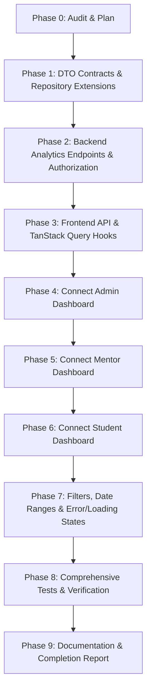

# AXV Nexus — Milestone 10: Technical Audit & Architecture Plan
**Milestone:** 10 — Dashboard & Analytics Integration  
**Date:** November 2026  
**Auditor:** Senior Full-Stack Software Architect & Engineer  
**Status:** Audit Complete — Ready for Implementation

---

## 1. Executive Summary

Milestone 10 focuses on eliminating static, hardcoded, placeholder, and mock dashboard data across the **AXV Nexus** platform, replacing them with authenticated, role-scoped, backend-driven analytics for **Admin**, **Mentor**, and **Student** users.

The audit examined:
1. Current backend analytics module (`uz.axm.nexus.analytics.*`).
2. Current frontend dashboards (`AdminDashboardView`, `MentorDashboardView`, `StudentDashboardView`, and `AnalyticsDashboard`).
3. Authorization and context resolution mechanisms (`ResourceOwnershipService`, `AnalyticsAuthorizationService`, `CurrentUserHelper`).
4. Scheduling, classroom, attendance, assignment, and grading data relationships.
5. Previous failure logs and root causes.

---

## 2. Failure Investigation (Previous Execution)

The previous execution trace reported task failures during test execution. 

### Root Cause Analysis:
- In the project root (`/home/izzatbek/Desktop/axvhub`), running `./gradlew` fails with `bash: line 1: ./gradlew: No such file or directory` because the Gradle wrapper resides in `backend/gradlew`.
- Running `npm test` from the root fails with `npm error enoent Could not read package.json` because the Vite React application resides in `frontend/package.json`.
- When invoked in their respective workspace roots:
  - `(cd backend && ./gradlew test)` **144/144 tests pass (100%)** across 25 suites.
  - `(cd frontend && npm test -- --run)` **135/135 tests pass (100%)** across 25 test files.
  - `(cd frontend && npm run build)` **Build succeeds in 1.32s** with 0 errors.

**Conclusion:** All existing business logic from Milestones 01–09 is healthy, intact, and 100% verified. Future commands must execute inside `backend/` or `frontend/`.

---

## 3. Existing Analytics Architecture & Endpoints

### 3.1 Backend Module Structure
Package: `uz.axm.nexus.analytics`
- `presentation.AnalyticsController`:
  - `GET /api/analytics/overview` (Super Admin, Admin, Coordinator)
  - `GET /api/analytics/student/{studentId}` (Authenticated)
  - `GET /api/analytics/group/{groupId}` (Admin, Mentor)
  - `GET /api/analytics/assessment/{assessmentId}` (Admin, Mentor)
  - `GET /api/analytics/mentor/{mentorId}` (Admin, Mentor, Observer)
  - `GET /api/analytics/subjects` (Authenticated)
  - `GET /api/analytics/academic-period/{periodId}` (Admin, Coordinator)
  - `GET /api/analytics/rules` (Documentation of metric calculation rules)
- `application.AnalyticsService`:
  - Implements operational metrics based on `Student`, `StudyGroup`, `AttendanceRecord`, `LessonSession`, `Assessment`, `StudentAssessmentAttempt`, `Assignment`, and `AssignmentSubmission`.
- `application.AnalyticsAuthorizationService`:
  - Helper to validate access to student and group analytics.

### 3.2 Authorization Gaps in Existing Analytics
1. **Ad-hoc Mentor and Student Resolution:**
   `AnalyticsAuthorizationService` attempts to match mentors by `m.getEmail()` or `m.getFullName()` and students by `student.getPinfl()` or `student.getStudentIdNumber()`. It does **not** reuse the verified `ResourceOwnershipService` from Milestone 09 (`findByUserId`).
2. **Missing Mentor IDOR Protection:**
   In `AnalyticsController.getMentorActivity(@PathVariable Long mentorId)`, there is no check ensuring that the requesting mentor owns `mentorId` or is an admin. Any authenticated mentor can view another mentor's full workload.
3. **No Dedicated Role Dashboard Endpoints:**
   There are currently no authenticated role-specific dashboard endpoints (`/api/analytics/dashboard/admin`, `/api/analytics/dashboard/mentor`, `/api/analytics/dashboard/student`).
4. **Mocked Trend Generation:**
   `AnalyticsService.generateSystemWeeklyTrend` uses hardcoded formulas (`94.5 + ...`, `85.0 + ...`) and `generateGroupWeeklyTrend` uses hardcoded scores (`86.0`), which violates data integrity standards.

---

## 4. Frontend Dashboard Inventory & Mock Data Audit

| Component | Current State | Mock / Hardcoded Data Found |
| :--- | :--- | :--- |
| **AdminDashboardView** (`AdminDashboardView.tsx`) | Renders executive banner, KPIs, attendance chart, IT lab occupancy, schedule table. | 1. `attendanceDays`: Hardcoded array: Monday 98%, Tuesday 97%, Wednesday 99%, Thursday 96%, Friday 98%, Saturday 95% (Average 97.2%). 2. `itLabs`: Hardcoded array: "IT Lab 1 — Web Full-Stack" 24/24 (100%), "IT Lab 2 — Algoritmlash & C++" 22/24 (92%), "IT Lab 3 — Mobil Dasturlash" 20/24 (83%), "IT Lab 4 — Sun’iy Intellekt & Data" 24/24 (100%). 3. Static trends in KPI cards (`+100% reja`, `100% qamrov`, etc.). |
| **MentorDashboardView** (`MentorDashboardView.tsx`) | Renders mentor greeting, next lesson card, 4 KPIs, today's schedule, student growth, pending submissions. | 1. Next lesson: Hardcoded `YA-24I1105 · IT`, `11-sinf • 16:30 • Xona: IT-2`. 2. KPIs: Today's lessons `{groups.length > 0 ? groups.length : 2}`, Assigned students `{students.length > 0 ? ... : '29 ta o‘quvchi biriktirilgan'}`, Today's attendance `100%`, Grading queue `0`. 3. Student growth: Hardcoded `92.6%`, `95.1%`, `89.4%`. 4. Pending reviews: Hardcoded list (`Bobur Aliyev`, `Jasur Eshchanov`, `Shahlo Qodirova`). |
| **StudentDashboardView** (`StudentDashboardView.tsx`) | Renders student greeting, Level & XP badge, 4 KPIs, today's lesson, active tasks, quiz feedback, recommended materials. | 1. XP and Level: Hardcoded `1,450 XP`, `Level 4`. 2. KPIs: GPA `94.8 / 100`, Course Progress `68%`, Attendance `100%`, Badges `7`. 3. Today's lesson: Hardcoded `14:00 – 15:20`, `IT Lab 1`, `HTML5 Semantic & Flexbox Layout asoslari`, `Dilnoza Rahimova`. 4. Active tasks: Hardcoded tasks `Flexbox Layout...`, `Massivlar va qidiruv...`, `TypeScript interface...`. 5. Latest Quiz Feedback: Hardcoded `94 / 100`, `CSS Box Model & Grid Amaliyoti`, `Dilnoza Rahimova`. |
| **AnalyticsDashboard** (`AnalyticsDashboard.tsx`) | Tabbed view for system overview, group, student, and rules documentation with PDF export. | Already queries `/api/analytics/*`, but uses imperative `useState` rather than TanStack Query, uses fallback student ID `students[0]?.id`, and has no mentor dashboard view. |

---

## 5. Target Dashboard Data Contracts

### 5.1 Admin Dashboard (`GET /api/analytics/dashboard/admin`)
- **Authorization:** `SUPER_ADMIN`, `ADMIN`, `PROGRAM_ADMIN`, `REGIONAL_COORDINATOR`
- **Parameters:** `from` (ISO LocalDate), `to` (ISO LocalDate), `groupId` (optional)
- **Response Structure:** `AdminDashboardDto`:
  - `overview`: `totalActiveStudents`, `totalMentors`, `totalGroups`, `totalScheduledLessons`, `systemAttendanceRate`, `systemAverageScore`, `totalCompletedLessons`, `totalSubmittedAssignments`
  - `attendanceSummary`: `presentCount`, `lateCount`, `excusedCount`, `absentCount`, `attendanceRate`
  - `weeklyAttendance`: List of `DailyAttendanceDto` (by day of week: Monday–Saturday, actual attendance records)
  - `roomOccupancy`: List of `RoomOccupancyDto` (room name, capacity, active sessions, occupancy rate)
  - `groupPerformance`: List of `GroupComparisonDto`
  - `enrollmentDistribution`: Student counts grouped by `gradeLevel`
  - `recentActivity`: Recent submissions, attempts, attendance sessions

### 5.2 Mentor Dashboard (`GET /api/analytics/dashboard/mentor`)
- **Authorization:** `MENTOR` (or admin viewing mentor)
- **Parameters:** `from` (ISO LocalDate), `to` (ISO LocalDate)
- **Identity Resolution:** Server-side `ResourceOwnershipService.getCurrentMentor()`
- **Response Structure:** `MentorDashboardDto`:
  - `mentorId`, `mentorName`, `specialization`, `branchLocation`
  - `todayLessonsCount` (real sessions scheduled for `LocalDate.now()`)
  - `assignedGroupsCount`, `assignedStudentsCount`
  - `todayAttendanceRate` (average attendance for today's sessions, or period rate)
  - `pendingGradingCount` (un-graded submissions across mentor's assignments)
  - `todayLessons`: List of `ScheduledSessionDto` (startTime, endTime, room, subject, groupCode, gradeLevel, studentCount)
  - `nextLesson`: Soonest upcoming session
  - `weeklyAttendanceTrend`: List of `TrendDataPointDto` across mentor's groups
  - `pendingSubmissions`: List of `PendingSubmissionDto` (submissionId, assignmentTitle, studentName, groupCode, submittedAt)
  - `studentGrowth`: Real average scores for theory (assessments), coding practice (assignments), and projects

### 5.3 Student Dashboard (`GET /api/analytics/dashboard/student`)
- **Authorization:** `STUDENT` (or admin/mentor authorized to view student)
- **Parameters:** `from` (ISO LocalDate), `to` (ISO LocalDate)
- **Identity Resolution:** Server-side `ResourceOwnershipService.requireCurrentStudent()`
- **Response Structure:** `StudentDashboardDto`:
  - `studentId`, `studentName`, `studentIdNumber`, `gradeLevel`, `groupCode`, `mentorName`, `branchLocation`
  - `gpa` / `overallAverageScore` (weighted 60% assessment, 40% assignments)
  - `attendanceRate`, `presentCount`, `lateCount`, `absentCount`, `excusedCount`
  - `lessonCompletionRate`, `completedLessonsCount`, `totalCurriculumLessons`
  - `gamification`: `totalPoints`, `level`, `rank`, `currentStreak`, `longestStreak`, `badgesCount`
  - `todayLessons`: List of `ScheduledSessionDto` scheduled for the student's group today
  - `approachingDeadlines`: List of `ActiveTaskDto` (id, title, subject, deadline, isUrgent, isSubmitted)
  - `latestFeedback`: Most recent graded submission or attempt feedback

---

## 6. Implementation Plan

### Step-by-Step Milestones:
1. **Backend Extensions:**
   - Create `RoomRepository` in `uz.axm.nexus.classrooms.infrastructure`.
   - Update `AnalyticsAuthorizationService` to delegate student and mentor identity to `ResourceOwnershipService`.
   - Add dashboard DTOs: `AdminDashboardDto`, `MentorDashboardDto`, `StudentDashboardDto`, and supporting sub-DTOs.
   - Implement `getAdminDashboard`, `getMentorDashboard`, and `getStudentDashboard` in `AnalyticsService`.
   - Implement clean weekly day-of-week attendance calculation from actual `AttendanceRecord` entities.
   - Implement real room occupancy based on `Room` entities and today's `LessonSession` scheduled.
   - Expose endpoints in `AnalyticsController`:
     - `GET /api/analytics/dashboard/admin`
     - `GET /api/analytics/dashboard/mentor`
     - `GET /api/analytics/dashboard/student`
   - Write integration tests in `backend/src/test/java/uz/axm/nexus/analytics/presentation/DashboardAnalyticsIntegrationTest.java`.
2. **Frontend Extensions:**
   - Define TypeScript interfaces in `frontend/src/types/index.ts` matching backend dashboard DTOs.
   - Add API methods in `frontend/src/api.ts`:
     - `analyticsApi.getAdminDashboard(params)`
     - `analyticsApi.getMentorDashboard(params)`
     - `analyticsApi.getStudentDashboard(params)`
   - Create custom TanStack Query hooks in `frontend/src/features/analytics/useDashboardAnalytics.ts`:
     - `useAdminDashboard(filters)`
     - `useMentorDashboard(filters)`
     - `useStudentDashboard(filters)`
     - Scoped cache keys: `['dashboard-admin', filters]`, `['dashboard-mentor', user.id, filters]`, `['dashboard-student', user.id, filters]`.
   - Connect `AdminDashboardView.tsx`: replace mock `attendanceDays` and `itLabs` with live backend data, skeletons for loading, and empty states.
   - Connect `MentorDashboardView.tsx`: replace mock next lesson, mock reviews, mock KPIs with live mentor dashboard data.
   - Connect `StudentDashboardView.tsx`: replace mock XP, GPA, attendance, today's lesson, active tasks with live student dashboard data.
   - Update localization in `frontend/src/shared/i18n/locales/uz.ts`, `ru.ts`, `en.ts` for any new dashboard labels.
3. **Verification:**
   - Execute backend test suite: `(cd backend && ./gradlew test --rerun)`.
   - Execute frontend test suite: `(cd frontend && npm test -- --run)`.
   - Execute frontend production build: `(cd frontend && npm run build)`.
   - Produce documentation: `docs/milestones/MILESTONE_10_DASHBOARD_ANALYTICS_INTEGRATION.md` and `MILESTONE_10_COMPLETION_REPORT.md`.

---

## 7. Performance & Security Considerations

1. **Database Efficiency:**
   - Group queries and aggregate counts rather than looping over all database rows.
   - For `RoomOccupancy`, query sessions for today's date rather than scanning historical sessions.
   - Filter `AttendanceRecord` by indexed date range (`BETWEEN :start AND :end`).
2. **Cache Isolation:**
   - Query keys for mentor and student dashboards must be prefixed with `auth.user.id`.
   - `queryClient.clear()` from Milestone 09 ensures no cross-user data leakage occurs upon logout or switching roles.
3. **IDOR & Role Boundaries:**
   - `GET /api/analytics/dashboard/student` and `GET /api/analytics/dashboard/mentor` ignore any client-sent identity and resolve strictly from Spring Security session context.
   - `GET /api/analytics/dashboard/admin` rejects non-admin users with HTTP 403.
