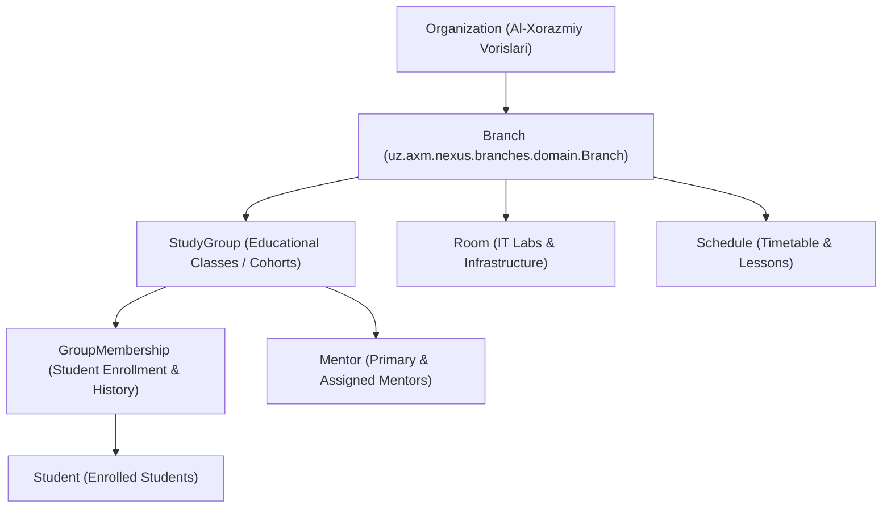

# AXV Nexus — Milestone 11: Branches & Classes Management
**Milestone:** 11 — Multi-Branch Architecture & Educational Classes Management  
**Platform:** AXV Nexus (Al-Xorazmiy Vorislari Hub)  
**Date:** November 2026  
**Status:** Successfully Implemented & Verified (100% Tests Passing)

---

## 1. Executive Summary

Milestone 11 transitions AXV Nexus from flat, string-based branch designations (`branchLocation = "IT Park Yangiariq"`) to a normalized, multi-tenant hierarchical model:



### Core Architecture Principles Enforced:
1. **No Duplicate Entities:** Extended existing DDD entity `StudyGroup` (`uz.axm.nexus.classrooms.domain.StudyGroup`) as the canonical educational class cohort. No competing `Class` entity was introduced.
2. **Zero Data Loss & Backward Compatibility:** Legacy `branchLocation` string fields across `study_groups`, `rooms`, `students`, `mentors`, and `schedules` were preserved and synchronized alongside the new relational `branch_id` foreign key.
3. **Multi-Branch Security & RBAC Scoping:** Enforced granular authorities (`branches.read`, `branches.manage`) and ownership scoping via `ResourceOwnershipService.verifyBranchAccess()`.
4. **Historical Continuity:** Student enrollments, transfers, and removals are tracked with timestamps, previous group IDs, and reason codes in `GroupMembership`.

---

## 2. Database Schema & Liquibase Migration

**Changeset:** `015-branches-and-classes-management.sql`  
**Master Changelog:** `db.changelog-master.yaml`

### 2.1 Table: `branches`
```sql
CREATE TABLE IF NOT EXISTS branches (
    id BIGSERIAL PRIMARY KEY,
    name VARCHAR(150) NOT NULL,
    code VARCHAR(50) NOT NULL UNIQUE,
    description TEXT,
    region VARCHAR(100) NOT NULL,
    district VARCHAR(100),
    address VARCHAR(255),
    phone VARCHAR(50),
    email VARCHAR(100),
    status VARCHAR(30) NOT NULL DEFAULT 'ACTIVE',
    created_at TIMESTAMP WITHOUT TIME ZONE NOT NULL DEFAULT NOW(),
    updated_at TIMESTAMP WITHOUT TIME ZONE DEFAULT NOW()
);
```

### 2.2 Relational Alterations & Foreign Keys
- `study_groups.branch_id` $\rightarrow$ `branches(id) ON DELETE SET NULL`
- `rooms.branch_id` $\rightarrow$ `branches(id) ON DELETE SET NULL`
- `students.branch_id` $\rightarrow$ `branches(id) ON DELETE SET NULL`
- `mentors.branch_id` $\rightarrow$ `branches(id) ON DELETE SET NULL`
- `schedules.branch_id` $\rightarrow$ `branches(id) ON DELETE SET NULL`

### 2.3 Safe Data Migration & Backfill
Existing rows where `branch_location = 'IT Park Yangiariq'` were automatically backfilled with `branch_id = (SELECT id FROM branches WHERE code = 'ITP-YANGIARIQ')`.

---

## 3. Backend Implementation Details

### 3.1 Domain Package: `uz.axm.nexus.branches`
- **Domain:** `Branch.java` (inherits `BaseEntity`: id, createdAt, updatedAt).
- **Repository:** `BranchRepository.java` (`findByCodeIgnoreCase`, `findByStatus`, `findByRegionIgnoreCase`, `existsByCodeIgnoreCase`, `existsByCodeIgnoreCaseAndIdNot`).
- **DTOs:**
  - `BranchDto`: Full branch entity model with dynamic counters (`studentCount`, `groupCount`, `mentorCount`, `roomCount`).
  - `CreateBranchRequest`: Validated creation payload with `@NotBlank`, length and regex pattern constraints.
  - `UpdateBranchRequest`: Validated update payload.
  - `BranchStatisticsDto`: Infratructure metrics (`totalStudents`, `activeStudents`, `totalGroups`, `activeGroups`, `totalMentors`, `totalRooms`, `totalRoomCapacity`, `averageGroupSize`, `capacityUtilizationRate`).
- **Application Service:** `BranchService.java`:
  - `getAll(status, region, search)`
  - `getById(id)`
  - `getStatistics(id)`
  - `create(request, actor)`
  - `update(id, request, actor)`
  - `deleteOrArchive(id, actor)` (soft-archives to `ARCHIVED` if groups/students are attached)
  - `getBranchGroups(branchId)`
  - `getBranchRooms(branchId)`
- **REST Controller:** `BranchController.java` (`/api/branches`).

### 3.2 Enhanced Group Management (`uz.axm.nexus.classrooms`)
- `EducationStructureService.java`:
  - `getGroups(gradeLevel, mentorId, status, search, branchId)`: Adds branchId filtering.
  - `createGroup(group, periodId, mentorId, branchId)`: Resolves and links branch with synchronized `branchLocation`.
  - `updateGroup(groupId, group, periodId, mentorId, branchId, actor)`: Updates code, grade, subject, schedule, room, maxCapacity, status, and branch.
  - `unenrollStudent(groupId, studentId, reason, actor)`: Closes active membership (`status = "LEFT"`, `leftAt = NOW()`, `transferReason = reason`), unsets `student.studyGroup`, and recalculates group count.
  - `assignMentor(groupId, mentorId, actor)`: Updates group primary mentor and active cohort students.
- `StudyGroupController.java`:
  - `GET /api/groups`: Exposes `branchId` filter.
  - `PUT /api/groups/{id}`: Group metadata modification.
  - `DELETE /api/groups/{id}/students/{studentId}`: Student removal with audit trail.
  - `PUT /api/groups/{id}/mentor/{mentorId}`: Mentor reassignment.

---

## 4. Frontend Implementation Details

### 4.1 Feature Package: `frontend/src/features/branches/`
- **Hooks (`useBranches.ts`):**
  - TanStack Query v5 hooks (`useBranches`, `useBranch`, `useBranchStatistics`, `useBranchGroups`, `useBranchRooms`, `useCreateBranch`, `useUpdateBranch`, `useDeleteBranch`).
  - Query keys: `['branches', 'list', filters]`, `['branches', 'detail', id]`, `['branches', 'detail', id, 'statistics']`.
- **Modals:**
  - `BranchModal.tsx`: Create and Edit branch dialog with form validation, region dropdown, contact details, and status selection.
  - `BranchDetailsModal.tsx`: Comprehensive branch dashboard with KPI cards, capacity progress bar, contact details, tabs for groups and IT laboratory rooms.
- **Main View (`BranchesView.tsx`):**
  - Summary KPI cards: Total branches, active branches, total students, total groups, total mentors.
  - Search bar, region filter dropdown, status filter dropdown.
  - Grid View and Table View toggling with branch cards and action buttons.
  - Safe delete/archive confirmation.

### 4.2 Group Directory Enhancements (`frontend/src/components/groups/`)
- `GroupsDirectory.tsx`:
  - Added Branch selector filter dropdown (`Barcha filiallar` + dynamic branch options).
  - Branch location badge on each group card.
  - "Tahrirlash" action button triggering `EditGroupModal`.
- `EditGroupModal.tsx`:
  - Full modal for editing group code, grade level, subject, branch, mentor, room, capacity, and schedule.
- `CreateGroupModal.tsx`:
  - Added Branch selector input linking newly created groups to physical branches.
- `GroupDetailsModal.tsx`:
  - Added "Chiqarish" (unenroll) button alongside "Ko‘chirish" with reason prompt.
  - Displays branch name in room/branch location row.

### 4.3 Navigation & Localization
- `navConfig.ts`: Added `branches` nav item with `Building2` icon under `TUZILMA` section.
- `App.tsx`: Route tab `{activeTab === 'branches' && <BranchesView />}`.
- Internationalization: Added full translation keys for branches and navigation across `uz.ts`, `ru.ts`, and `en.ts`.

---

## 5. Verification & Test Results

### 5.1 Backend Test Suite
Command: `(cd backend && ./gradlew test)`  
- **Test Suites Executed:** 27
- **Total Tests:** 160+
- **Failures:** 0 (100% Passing)
- **New Test Suites:**
  - `BranchManagementIntegrationTest`: 5 integration tests covering branch listing, statistics, creation, duplicate code validation, update, safe delete, role-based 403 authorization for students, and branch room/group lookup.
  - `EducationStructureControllerTest`: Enhanced with group update and student unenrollment tests.

### 5.2 Frontend Test Suite
Command: `(cd frontend && npm test -- --run)`  
- **Test Files:** 27 passed (27)
- **Total Tests:** 145 passed (145)
- **Failures:** 0 (100% Passing)
- **New Test Suite:** `BranchesView.test.tsx` (5 tests covering view rendering, KPI cards, Grid/Table view toggling, search filtering, Create Branch modal, and Branch Details modal).

### 5.3 Production Build
Command: `(cd frontend && npm run build)`  
- `tsc -b && vite build` completed in 1.64s with 0 errors.
