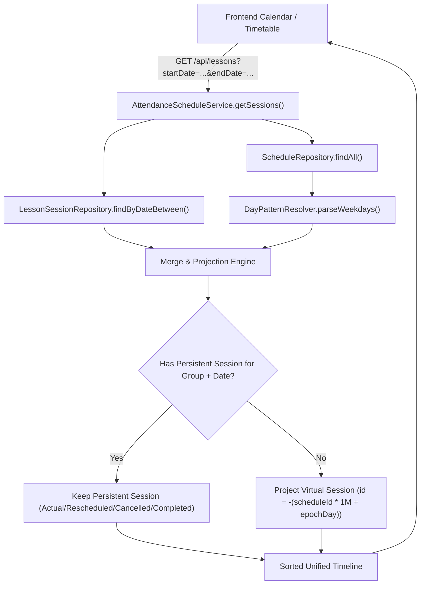

# AXV NEXUS — SCHEDULING WORKFLOW IMPLEMENTATION
## Recurring Timetables, Individual Lesson Sessions, Calendar & Data Synchronization

**Status:** Successfully Implemented & Verified  
**Milestone:** Scheduling Workflow Correction & Integration  
**Date:** 2026-11-14  
**Author:** Antigravity AI  

---

## 1. Architectural Overview & Domain Separation

The AXV Nexus platform strictly differentiates between two distinct operational boundaries within the scheduling domain:

### Operation A: Recurring Weekly Timetable
- **Domain Entity:** `Schedule` (`schedules` table).
- **Purpose:** Defines the persistent weekly routine for a study group across a semester or academic year.
- **Academic Weekday Patterns:**
  - `ODD_DAYS` (Toq kunlar): Automatically resolves to Monday, Wednesday, Friday.
  - `EVEN_DAYS` (Juft kunlar): Automatically resolves to Tuesday, Thursday, Saturday.
  - `ALL_SIX_DAYS` (Barcha 6 kun): Automatically resolves to Monday through Saturday.
  - `CUSTOM` (Maxsus kunlar): User-specified combination of Monday through Saturday.
  - *Sunday (`YAKSHANBA`) is strictly prohibited in the 6-day academic calendar model.*
- **Database Bloat Prevention:** Stored as a single recurring definition per group and subject. It **never** creates endless future database rows.

### Operation B: Individual Lesson Session
- **Domain Entity:** `LessonSession` (`lesson_sessions` table).
- **Purpose:** Represents one specific lesson on a concrete calendar date (e.g. `2026-11-20`), holding topic notes, attendance status, and student attendance records (`AttendanceRecord`).
- **Isolation:** Scheduling an individual session does not modify or overwrite the group's recurring timetable.

---

## 2. Virtual Calendar Projection Architecture

To solve the empty state in future/past months (such as November 2026) without persistent database bloat:



### Deterministic Reversible Virtual IDs:
- Virtual sessions receive negative deterministic IDs:  
  `virtualId = -(schedule.getId() * 1000000L + Math.abs(date.toEpochDay()))`
- When an administrative action occurs on a virtual session (such as submitting attendance via `POST /api/lessons/{id}/attendance`, rescheduling via `POST /api/lessons/{id}/reschedule`, or cancelling via `POST /api/lessons/{id}/cancel`):
  `AttendanceScheduleService` extracts `scheduleId` and `origDate`, instantiates an actual `LessonSession` row in the database, and performs the operation.
- Subsequent calendar queries encounter the persisted row and replace the virtual projection with the actual record.

---

## 3. Structured Conflict Detection & Resolution

### Conflict Response DTO:
When an overlap is detected during schedule creation or session planning:
```json
{
  "success": false,
  "code": "SCHEDULE_CONFLICT",
  "errorCode": "SCHEDULE_CONFLICT",
  "message": "Xona (IT Lab 1) Seshanba kuni band! Unda YA-26I0804 darsi mavjud (15:00 - 16:30)",
  "conflicts": [
    {
      "type": "CLASSROOM",
      "weekday": "TUESDAY",
      "resourceName": "IT Lab 1",
      "existingGroupCode": "YA-26I0804",
      "startTime": "15:00",
      "endTime": "16:30"
    }
  ]
}
```

### Frontend Visual Highlight:
- `ManualScheduleModal.tsx` and `CreateLessonModal.tsx` catch `SCHEDULE_CONFLICT`.
- The specific conflicting weekday badge (e.g. `weekday-btn-TUESDAY`) is highlighted in red with a glowing border (`border-rose-500 bg-rose-500/25 ring-2 ring-rose-500 text-rose-500`).
- The conflict card displays the occupied resource, conflicting group code, and scheduled time window, with quick actions to switch parity (Toq/Juft) or choose another room.

---

## 4. API Inconsistency Corrections

1. **Dual Endpoint Mapping for Admin Operations:**
   - Updated `AdminOperationsController.java` to `@RequestMapping({"/api/admin", "/api/v1/admin"})`.
   - Updated `frontend/src/api.ts` `adminApi` to map to `/admin/...` endpoints.
   - Fixed `No static resource api/v1/admin/overview` 404 error.

2. **Analytics & Selector Hardcoded Fallback Prevention:**
   - In `AnalyticsDashboard.tsx`, removed hardcoded default `10`. Synchronized `selectedGroupId` with `groups` using `useEffect`.
   - In `CreateLessonModal.tsx`, synchronized `groupId` and `mentorId` with available `groups` and `mentors`.
   - Fixed `IllegalArgumentException: Guruh topilmadi: 10`.

---

## 5. Cache Invalidation Strategy

Using centralized TanStack `queryClient`:
- **Recurring Schedule Creation / Update / Delete:**
  - `queryClient.invalidateQueries({ queryKey: ['schedules'] })`
  - `queryClient.invalidateQueries({ queryKey: ['lessons'] })`
  - `queryClient.invalidateQueries({ queryKey: ['dashboard-admin'] })`
  - `queryClient.invalidateQueries({ queryKey: ['dashboard-mentor'] })`
  - `queryClient.invalidateQueries({ queryKey: ['dashboard-student'] })`
- **Individual Lesson Session (Create / Cancel / Reschedule / Attendance):**
  - `queryClient.invalidateQueries({ queryKey: ['lessons'] })`
  - `queryClient.invalidateQueries({ queryKey: ['today-sessions'] })`
  - `queryClient.invalidateQueries({ queryKey: ['dashboard-admin'] })`
  - `queryClient.invalidateQueries({ queryKey: ['dashboard-mentor'] })`
  - `queryClient.invalidateQueries({ queryKey: ['dashboard-student'] })`
