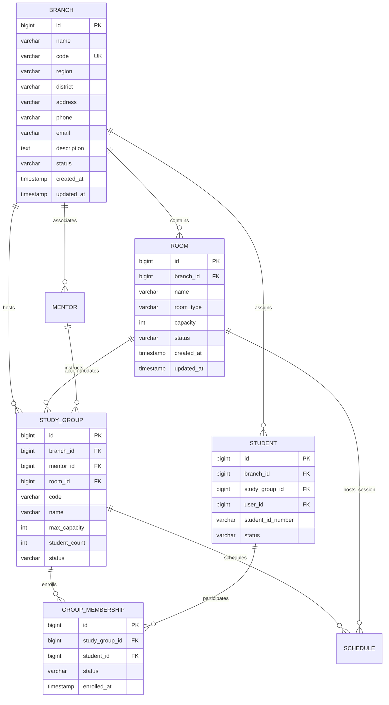

# AXV Nexus — Branches & Centers Implementation Guide

## 1. Overview & Architectural Scope

This document provides a comprehensive technical overview of the **Branches & Centers (Filiallar va Markazlar)** module implementation in **AXV Nexus (Al-Xorazmiy Vorislari Hub)**.

The module provides end-to-end branch lifecycle administration, classroom and laboratory inventory management, cohort capacity enforcement, multi-tab audit views, and strict multi-tenant authorization controls.

---

## 2. Architecture & Domain Relationships

The following entity-relationship diagram illustrates the stabilized domain model:

---

## 3. Backend Implementation

### 3.1 Data Transfer Objects (DTOs)

The presentation layer is strictly decoupled from JPA entities via dedicated immutable and validated DTOs:

* **[BranchStatisticsDto](file:///home/izzatbek/Desktop/axvhub/backend/src/main/java/uz/axm/nexus/branches/application/dto/BranchStatisticsDto.java):**
  Encapsulates authoritative counts: `totalStudents`, `totalGroups`, `totalMentors`, `totalRooms`, `totalRoomCapacity`, `capacityUtilizationRate` (nullable), and `hasCapacityData` (boolean flag).
* **[BranchGroupDto](file:///home/izzatbek/Desktop/axvhub/backend/src/main/java/uz/axm/nexus/branches/application/dto/BranchGroupDto.java):**
  Represents study groups under a branch, exposing `groupCode`, `gradeLevel`, `subjectName`, `mentorName`, `roomName`, `activeStudentCount`, `maxCapacity`, `isOverCapacity`, and `status`.
* **[BranchRoomDto](file:///home/izzatbek/Desktop/axvhub/backend/src/main/java/uz/axm/nexus/branches/application/dto/BranchRoomDto.java):**
  Exposes classroom attributes including `name`, `roomType`, `capacity`, `currentOccupancy`, `assignedGroupsCount`, `status`, and `createdAt`.
* **[BranchMentorDto](file:///home/izzatbek/Desktop/axvhub/backend/src/main/java/uz/axm/nexus/branches/application/dto/BranchMentorDto.java):**
  Surfaces assigned mentor information: `fullName`, `email`, `phone`, `specialization`, `assignedGroupsCount`, `weeklyWorkloadHours`, and `status`.
* **[BranchActivityDto](file:///home/izzatbek/Desktop/axvhub/backend/src/main/java/uz/axm/nexus/branches/application/dto/BranchActivityDto.java):**
  Surfaces audit entries for the branch: `action`, `actorUsername`, `details`, and `timestamp`.
* **[CreateRoomRequest](file:///home/izzatbek/Desktop/axvhub/backend/src/main/java/uz/axm/nexus/branches/application/dto/CreateRoomRequest.java) & [UpdateRoomRequest](file:///home/izzatbek/Desktop/axvhub/backend/src/main/java/uz/axm/nexus/branches/application/dto/UpdateRoomRequest.java):**
  Validates room creation and modification parameters (`@NotBlank name`, `@Min(1) capacity`, `roomType`, `status`).

---

### 3.2 Services

#### [BranchService.java](file:///home/izzatbek/Desktop/axvhub/backend/src/main/java/uz/axm/nexus/branches/application/BranchService.java)
* **Authoritative Statistics (`getBranchStatistics`):**
  Aggregates active students from `StudentRepository`, active groups from `StudyGroupRepository`, distinct mentors from assigned groups, and active rooms from `RoomRepository`.
  Computes `capacityUtilizationRate` only when active room capacity is greater than 0, safely returning `null` when room data is unconfigured.
* **Room Management (`getBranchRooms`, `createRoom`, `updateRoom`, `deleteOrDeactivateRoom`):**
  Enforces case-insensitive unique room name checks within the same branch.
  Protects rooms with active group assignments from hard deletion by transitioning them to `INACTIVE`.
* **Safe Branch Archival (`deleteBranch`):**
  Checks whether the branch has active study groups or students. If populated, switches `status = 'ARCHIVED'` rather than cascading physical deletes, preserving all academic and attendance history.

#### [EducationStructureService.java](file:///home/izzatbek/Desktop/axvhub/backend/src/main/java/uz/axm/nexus/classrooms/application/EducationStructureService.java)
* **Capacity Enforcement & Override (`enrollStudent`):**
  Validates that group enrollment does not exceed `maxCapacity`.
  When `allowCapacityOverride = true` is supplied by an authorized administrator with an `overrideReason`, the enrollment proceeds and an audit record (`GROUP_CAPACITY_OVERRIDE`) is permanently written to `AuditService`.

#### [ResourceOwnershipService.java](file:///home/izzatbek/Desktop/axvhub/backend/src/main/java/uz/axm/nexus/shared/application/ResourceOwnershipService.java)
* **IDOR Protection (`verifyBranchAccess`):**
  Resolves the current authenticated user's assigned student or mentor profile.
  Replaces insecure fallback behaviors with strict `AccessDeniedException` checks whenever a user attempts to query or mutate a branch outside their jurisdiction.

---

### 3.3 REST Endpoints

All endpoints are hosted under `/api/branches` and secured via Spring Security `@PreAuthorize`:

| Method | Endpoint | Description | Permitted Roles | Ownership Checked |
|---|---|---|---|---|
| `GET` | `/api/branches` | List branches (search, filter, paginate) | All Authenticated | No (Public Directory) |
| `GET` | `/api/branches/{id}` | Get branch by ID | All Authenticated | Yes (`verifyBranchAccess`) |
| `POST` | `/api/branches` | Create new branch | Admin, Super Admin | No |
| `PUT` | `/api/branches/{id}` | Update branch details | Admin, Super Admin | Yes |
| `DELETE` | `/api/branches/{id}` | Safely archive/delete branch | Admin, Super Admin | Yes |
| `GET` | `/api/branches/{id}/statistics` | Authoritative branch KPIs | All Authenticated | Yes (`verifyBranchAccess`) |
| `GET` | `/api/branches/{id}/groups` | Get branch study groups | All Authenticated | Yes (`verifyBranchAccess`) |
| `GET` | `/api/branches/{id}/rooms` | Get branch rooms | All Authenticated | Yes (`verifyBranchAccess`) |
| `POST` | `/api/branches/{id}/rooms` | Create branch room | Admin, Coordinator | Yes (`verifyBranchAccess`) |
| `PUT` | `/api/branches/{id}/rooms/{roomId}` | Update branch room | Admin, Coordinator | Yes (`verifyBranchAccess`) |
| `DELETE` | `/api/branches/{id}/rooms/{roomId}` | Deactivate/delete room | Admin, Coordinator | Yes (`verifyBranchAccess`) |
| `GET` | `/api/branches/{id}/mentors` | Get branch mentors | All Authenticated | Yes (`verifyBranchAccess`) |
| `GET` | `/api/branches/{id}/activity` | Get branch audit activity | Admin, Coordinator | Yes (`verifyBranchAccess`) |

---

## 4. Frontend Architecture

### 4.1 Component Breakdown

* **[BranchModal.tsx](file:///home/izzatbek/Desktop/axvhub/frontend/src/features/branches/BranchModal.tsx):**
  Form dialog for branch creation and editing. Provides field-level validation (code uniqueness, email format, phone format, required names and regions), error banners, and full internationalization.
* **[BranchDetailsModal.tsx](file:///home/izzatbek/Desktop/axvhub/frontend/src/features/branches/BranchDetailsModal.tsx):**
  Comprehensive 5-tab detail view:
  1. **General Overview:** Key statistics cards, capacity progress bar with division-by-zero safeguards, contact information, geographic location, and timestamps.
  2. **Groups:** Searchable and filterable table displaying grade level, subject, mentor, assigned room, active student count, capacity limits, and over-capacity warning tags.
  3. **Mentors:** Roster of active mentors, email/phone contact cards, specializations, assigned cohorts, and weekly workload hours.
  4. **Classrooms & Laboratories:** Room inventory table with room types, seat capacities, current occupancy, and inline Room Creation/Editing modals.
  5. **Activity / Audit History:** Chronological audit timeline of administrative mutations, overrides, and updates.
* **[useBranches.ts](file:///home/izzatbek/Desktop/axvhub/frontend/src/features/branches/useBranches.ts):**
  TanStack Query hooks managing queries and optimistic cache invalidations for statistics, groups, rooms, mentors, activity, and room mutations.

---

### 4.2 Theme & Design System Integration

All modal elements adhere to the Tailwind CSS design tokens:
- Background: `bg-card` and `bg-background`
- Borders: `border-border`
- Text hierarchy: `text-foreground`, `text-muted-foreground`
- Status badges: Semantic variants (`default`, `secondary`, `destructive`, `outline`)
- Contrast: Full compliance with light and dark theme modes.

---

### 4.3 Internationalization (i18n)

Full localization has been verified across all three supported languages:
- **Uzbek (`uz`)**: Default platform language.
- **English (`en`)**: Complete parity for administrative terms.
- **Russian (`ru`)**: Accurate contextual translations.
Translations are resolved dynamically via `useI18n()` / `useTranslation()`.
